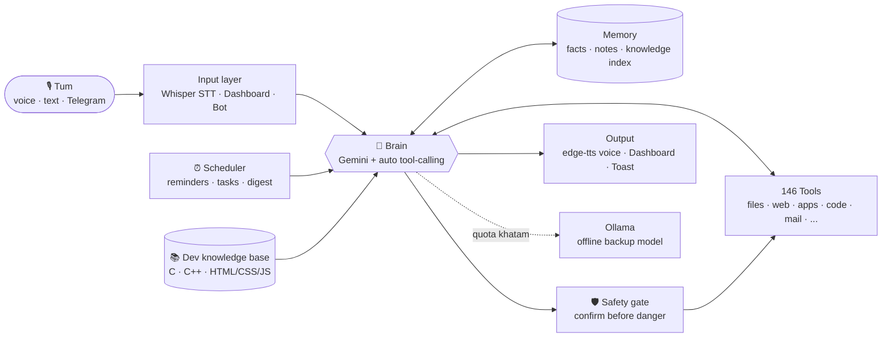
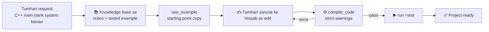

<div align="center">

```
 ██████╗ ██╗      █████╗  ██████╗██╗███████╗██████╗
██╔════╝ ██║     ██╔══██╗██╔════╝██║██╔════╝██╔══██╗
██║  ███╗██║     ███████║██║     ██║█████╗  ██████╔╝
██║   ██║██║     ██╔══██║██║     ██║██╔══╝  ██╔══██╗
╚██████╔╝███████╗██║  ██║╚██████╗██║███████╗██║  ██║
 ╚═════╝ ╚══════╝╚═╝  ╚═╝ ╚═════╝╚═╝╚══════╝╚═╝  ╚═╝
```

### Your AI companion. Always listening. Always on your side.

*Ek Jarvis-style assistant jo tumhare Windows PC par rehta hai: bolta hai, sunta hai, files dhundta hai, code likhta hai, aur kaam khatam karke batata hai.*

<br>


-8E75B2?style=for-the-badge&logo=googlegemini&logoColor=white)


<br>

[**Quick start**](#-quick-start-4-steps) &nbsp;·&nbsp; [**Terminal cheat sheet**](#-terminal-cheat-sheet-sab-commands-ek-jagah) &nbsp;·&nbsp; [**Features**](#-what-glacier-can-do) &nbsp;·&nbsp; [**Voice**](#-voice) &nbsp;·&nbsp; [**Coding mode**](#-coding-mode) &nbsp;·&nbsp; [**Reminders**](#-reminders-that-respect-time) &nbsp;·&nbsp; [**Safety**](#-safety-by-design) &nbsp;·&nbsp; [**.env guide**](#-env-settings-poori-list) &nbsp;·&nbsp; [**Help**](#-troubleshooting)

</div>

<br>

---

## ✦ Glacier kya hai

Glacier ek **personal AI assistant** hai jo seedha tumhare PC par chalta hai. Ek ice-and-aurora dashboard, hamesha sunne wala mic, aur 146 tools: apps kholna, files dhundhna, web research, reminders, email, aur C / C++ / HTML mein poore projects banana.

|  |  |
|---|---|
| 🧊 **Free** | Google Gemini ki free API key. Koi subscription nahi. |
| 🎙️ **Hands-free** | "Glacier, ..." bolo. Button dabane ki zaroorat nahi. |
| 🌍 **Multilingual** | 65 bhashaon mein bolta hai, sunte hi bhasha pehchanta hai, kisi bhi bhasha se kisi mein translate karta hai. |
| 🛡️ **Safe** | Delete, command, email jaise kaam **code se** tumhari confirmation maangte hain. AI khud "haan" nahi bol sakta. |
| 🔌 **Tumhara** | Data tumhare PC par. API key sirf `.env` mein. |

<br>

## ✦ Architecture



<br>

## ✦ Quick start (4 steps)

> **Zaroorat:** Windows 10/11, Python 3.12 (install karte waqt *Add python.exe to PATH* tick karna), internet, aur ek free Gemini key.

| # | Kya karo | Kaise |
|:-:|---|---|
| **1** | Folder kholo | Glacier ka folder (jisme `install.bat` hai). |
| **2** | **`install.bat`** double-click | Ye `.venv` banata hai, libraries install karta hai, `.env` banata hai aur Notepad kholta hai. |
| **3** | Key paste karo | Notepad mein `GEMINI_API_KEY=` ke aage free key daalo ([yahan se lo](https://aistudio.google.com/apikey)) aur save karo. |
| **4** | **`run.bat`** double-click | Dashboard khul jata hai. 🎉 |

> 💡 Pehle **`doctor.bat`** chala ke dekh sakte ho ki sab theek hai. Wo bata deta hai kya kharab hai aur kaise theek karna hai.

### PC on hote hi apne-aap chalu (tray mein)

Terminal mein Glacier ke folder ke **andar** rehkar:

```powershell
python setup_autostart.py            # chalu karo
python setup_autostart.py --remove   # band karo
```

> ⚠️ Agar `.venv` wala terminal ho to `python` hi kaafi hai. PowerShell mein `.venv\Scripts\python` seedha likhoge to error aayega; `.\.venv\Scripts\python` likhna padega.

<br>

## ✦ What Glacier can do

<table>
<tr>
<td width="50%" valign="top">

### 🗣️ Baat-cheet aur voice
Hinglish text, hamesha-on mic, gentle male awaaz, offline Whisper speech-to-text, wake word, system tray icon.

### 🖥️ Apps aur PC
App kholo/band karo, volume, brightness, media keys, lock, power (confirm ke saath), clipboard, dark mode, system status, disk hogs.

### 📁 Files
Poori drive mein instant search. PDF, DOCX, XLSX, CSV padhna. Likhna, edit, move, copy, rename, delete (Recycle Bin mein), zip/unzip, Downloads organize + undo.

### 🌐 Web aur info
Search, pages padhna, Wikipedia, YouTube, weather, news, currency, units, calculator, dictionary.

### 🔬 Deep research
Kai sources se cited report, `Documents\Glacier Reports` mein.

</td>
<td width="50%" valign="top">

### 🧠 Memory
Facts yaad rakhna, apne documents par knowledge index (BM25), notes, todos, calendar, contacts.

### ⏰ Reminders aur schedules
"10 minute baad", "kal subah 8 baje", roz/weekly repeat, scheduled AI tasks, page monitors, morning digest, battery/disk/CPU alerts.

### 👁️ Vision aur control
Screenshot dekhna, image samajhna, OCR, mouse/keyboard control (tumhari permission ke baad), screen agent.

### 🌍 Browser agent
Playwright se pages kholna, click, type, snapshot.

### 💬 Comms
WhatsApp (desktop app), email (IMAP/SMTP), Telegram bot (phone se Glacier + files).

### 🔗 API server
`API_SERVER_ENABLED=true` karo to `http://127.0.0.1:8765/v1/chat/completions` par dusre apps Glacier use kar sakte hain.

</td>
</tr>
</table>

<details>
<summary><b>📋 Tools ki poori ginti (146)</b></summary>

<br>

| Category | Tools | Category | Tools |
|---|:-:|---|:-:|
| Developer | 20 | Web | 7 |
| Files | 16 | Info | 7 |
| System | 12 | Comms | 7 |
| Productivity | 12 | Terminal | 6 |
| Schedule | 11 | Memory | 6 |
| PC control | 11 | Apps | 4 |
| Browser | 11 | Vision | 4 |
| Language | 4 | Skills / MCP / Agent / Custom | 8 |

Kisi bhi tool ko band karna ho: `.env` mein `DISABLED_TOOLS=run_command,run_python` ya `DISABLED_CATEGORIES=control,browser`.

</details>

<br>

## ✦ Tools reference (saare 146)

Ye list asli code se bani hai. ⚠️ = **confirmation ke baad hi chalta hai**. Descriptions English mein hain kyunki Glacier ka AI wahi padhta hai.

<details>
<summary><b>💻 Developer (C / C++ / HTML / C#)</b> · 20 tools</summary>

<br>

| Tool | Kya karta hai |
|---|---|
| `analyze_code`  | Analyze C/C++ code for bugs: cppcheck if installed, otherwise a strict compile (-Wshadow -Wconversion -Wnull-dereference -Wformat=2). |
| `build_project` ⚠️ | Build a project folder: CMakeLists.txt -&gt; cmake, Makefile -&gt; make, *.csproj -&gt; dotnet build, otherwise compile all .c/.cpp files. |
| `check_html`  | Validate an HTML file: structure (doctype, lang, charset, viewport, title, unclosed/mismatched tags), accessibility (alt text, form labels),... |
| `coding_guide`  | Return Glacier's expert coding rules and workflow for a language: 'html', 'c', 'cpp', 'csharp' (empty = all). |
| `compile_code`  | Compile a C or C++ source file (or every .c/.cpp in a folder) with warnings on (-Wall -Wextra -Wpedantic) and return the compiler errors/warnings. |
| `create_project`  | Create a starter project and return its folder. |
| `dev_reference`  | Search Glacier's built-in C / C++ / HTML / CSS / JavaScript reference notes (syntax, STL, pitfalls, compiler errors, project blueprints). |
| `dev_toolchain`  | Show which developer tools are installed (gcc, g++, clang, cmake, make, dotnet, node, git, clang-format, cppcheck) and how to install missing ones. |
| `format_code`  | Format a C/C++ source file in place with clang-format (4-space indent). |
| `gemini_models`  | List the Gemini models this API key can use (to pick a stronger model for coding via CODING_MODELS in .env). |
| `html_screenshot`  | Render an HTML file in a headless browser and save a screenshot (PNG). |
| `install_compiler` ⚠️ | Install a free C/C++ compiler (GCC via WinLibs) on Windows using winget. |
| `install_offline_docs` ⚠️ | Download C/C++ (cppreference) and HTML/CSS/JavaScript (MDN) documentation from GitHub once (about 150-250 MB, a few minutes) and index it so... |
| `list_examples`  | List Glacier's tested example projects. |
| `local_model_advice`  | Check this PC's RAM/GPU and recommend an offline coding model for Ollama, with exact install steps. |
| `lookup_docs`  | Look up live official documentation (cppreference.com for C/C++, MDN for HTML/CSS/JavaScript) for a function, header, tag or property. |
| `offline_docs_status`  | Show whether the offline C/C++/HTML/CSS/JS documentation is installed and the progress of a running download. |
| `preview_html`  | Open an HTML file in the user's default browser. |
| `run_program` ⚠️ | Run a compiled program (.exe) - or a C/C++ source file, which is compiled first - and return its output and exit code. |
| `use_example`  | Copy a tested example project into a new folder as a starting point (default: Documents\Glacier Projects\&lt;name&gt;), then adapt it with edit_file... |

</details>

<details>
<summary><b>📁 Files</b> · 16 tools</summary>

<br>

| Tool | Kya karta hai |
|---|---|
| `copy_file` ⚠️ | Copy a file or folder (original stays). |
| `create_folder`  | Create a new folder (parents too). |
| `delete_file` ⚠️ | Delete a file or folder. |
| `edit_file` ⚠️ | Replace exact text inside an existing text file (old_text must appear exactly once). |
| `file_info`  | Size, dates and type of a file or folder. |
| `find_files`  | Find files/folders by (part of) name anywhere on C: and D: (instant, uses an index; also catches brand-new files). |
| `list_folder`  | List the contents of a folder (use 'desktop', 'downloads', 'documents' as shortcuts). |
| `move_file` ⚠️ | Move (cut-paste) a file or folder. |
| `open_path`  | Open a file with its default app, or open a folder in File Explorer. |
| `organize_downloads` ⚠️ | Sort files in the Downloads folder into subfolders by type (Images, Documents, Videos, Music, Archives, Installers, Others). |
| `read_file`  | Read a file's text (txt, md, code, csv, json, PDF, Word .docx, Excel .xlsx ...). |
| `rename_file` ⚠️ | Rename a file/folder (new_name is just the new name, not a path). |
| `undo_organize_downloads`  | Undo the last organize_downloads: move every file back to where it was. |
| `unzip_file`  | Extract a .zip into a new folder next to it (or into destination). |
| `write_file` ⚠️ | Create a text file with the given content. |
| `zip_folder`  | Compress a folder (or single file) into a .zip next to it (or at output_path). |

</details>

<details>
<summary><b>🖥️ System</b> · 12 tools</summary>

<br>

| Tool | Kya karta hai |
|---|---|
| `clipboard_read`  | Return the text currently on the Windows clipboard. |
| `clipboard_write`  | Put text on the Windows clipboard so the user can paste it anywhere. |
| `empty_recycle_bin` ⚠️ | Permanently empty the Recycle Bin. |
| `get_disk_hogs`  | Which running programs use the most RAM and CPU right now (helps when the PC feels slow). |
| `get_network_info`  | Current network: Wi-Fi name, IP addresses, and whether the internet works. |
| `get_system_status`  | CPU, RAM, every disk, battery, uptime and network speed - a quick health report of this PC. |
| `lock_screen`  | Lock the Windows session (Win+L). |
| `media_control`  | Press a media key: play_pause / next / prev / stop. |
| `set_brightness`  | Set laptop screen brightness (0-100). |
| `set_dark_mode`  | Switch Windows between dark mode (True) and light mode (False). |
| `set_volume`  | Control speaker volume. |
| `system_power` ⚠️ | Power control: action = sleep / shutdown / restart / hibernate / logoff / cancel. |

</details>

<details>
<summary><b>✅ Productivity (todos, notes, calendar, contacts)</b> · 12 tools</summary>

<br>

| Tool | Kya karta hai |
|---|---|
| `add_contact`  | Save or update a contact (used by send_whatsapp / send_email so you can say 'Papa ko message bhejo'). |
| `add_event`  | Add an event to the local calendar. |
| `add_note`  | Save a note (ideas, meeting points, anything to remember in detail). |
| `add_todo`  | Add an item to the to-do list. |
| `complete_todo`  | Mark a to-do as done, by number (#id) or words from its text. |
| `delete_event`  | Delete a calendar event by number (#id) or words from its title. |
| `delete_note`  | Delete a note by number (#id). |
| `delete_todo`  | Remove a to-do entirely, by number (#id) or words from its text. |
| `find_contact`  | Find a saved contact by name (empty = list all). |
| `list_events`  | Show calendar events for the next N days (default 7; use 1 for today). |
| `list_todos`  | Show the to-do list (pending items; set show_done=True to include completed). |
| `search_notes`  | Search saved notes by words (empty query = latest notes). |

</details>

<details>
<summary><b>⏰ Reminders aur schedules</b> · 11 tools</summary>

<br>

| Tool | Kya karta hai |
|---|---|
| `add_reminder`  | Set a reminder. |
| `cancel_reminder`  | Cancel a reminder by its number (#id) or by words from its text. |
| `cancel_scheduled_task`  | Cancel a scheduled task by number (#id) or words from its name. |
| `edit_reminder`  | Change an existing reminder (find it by #id or words in its text): new text, new time ('kal 9 baje', '7pm') and/or new repeat. |
| `list_reminders`  | List upcoming reminders and running timers. |
| `list_scheduled_tasks`  | List all scheduled (recurring or future) Glacier tasks. |
| `list_watches`  | List all monitored pages. |
| `remove_watch`  | Stop monitoring a page by number (#id) or part of its URL. |
| `schedule_task`  | Schedule Glacier itself to do something later or repeatedly (like a cron job): at the given time Glacier runs 'prompt' as if the user typed it... |
| `set_timer`  | Start a countdown timer, e.g. |
| `watch_page`  | Monitor a web page. |

</details>

<details>
<summary><b>🖱️ PC control (mouse / keyboard / power)</b> · 11 tools</summary>

<br>

| Tool | Kya karta hai |
|---|---|
| `disable_computer_control`  | Turn mouse/keyboard control off immediately. |
| `enable_computer_control` ⚠️ | Ask the user's permission to control mouse & keyboard for N minutes (needed before mouse_click, type_text, press_key, screen_agent ...). |
| `focus_window`  | Bring a window to the front by part of its title (e.g. |
| `get_screen_info`  | Screen resolution and current mouse position. |
| `mouse_click`  | Click at screen pixel coordinates (x, y). |
| `mouse_move`  | Move the mouse pointer to (x, y). |
| `press_key`  | Press a key or shortcut, e.g. |
| `screen_agent` ⚠️ | Do a multi-step task by LOOKING at the screen and using mouse/keyboard like a person (last resort when no direct tool exists, e.g. |
| `scroll_screen`  | Scroll the active window: positive = up, negative = down (e.g. |
| `show_desktop`  | Minimize everything and show the desktop (Win+D). |
| `type_text`  | Type text into whatever has keyboard focus right now (supports Hindi/any language). |

</details>

<details>
<summary><b>🌍 Browser agent</b> · 11 tools</summary>

<br>

| Tool | Kya karta hai |
|---|---|
| `browser_click` ⚠️ | Click a button/link/element by its visible text, label, or a CSS selector ('css=#submit'). |
| `browser_close`  | Close Glacier's automation browser. |
| `browser_links`  | List links on the current page (optionally only those whose text/URL contains a word). |
| `browser_open`  | Open a URL in Glacier's automation browser (separate window with its own saved logins). |
| `browser_press`  | Press a key on the current page, e.g. |
| `browser_read`  | Read the visible text of the current page in Glacier's browser. |
| `browser_screenshot`  | Screenshot of the current page in Glacier's browser. |
| `browser_scroll`  | Scroll the page: direction 'down' or 'up'. |
| `browser_snapshot`  | Accessibility snapshot of the page (buttons, links, inputs with their names) - use this to decide what to click/type. |
| `browser_tabs`  | Manage tabs: action = list / new (opens url) / switch (to index) / close (current tab) / back. |
| `browser_type` ⚠️ | Type text into an input field (found by label/placeholder/name/css). |

</details>

<details>
<summary><b>🔎 Web</b> · 7 tools</summary>

<br>

| Tool | Kya karta hai |
|---|---|
| `download_file` ⚠️ | Download a file from a public URL into the Downloads folder (never overwrites, max 500 MB). |
| `fetch_url`  | Download a web page and return its readable text (no browser needed). |
| `http_request` ⚠️ | Make an HTTP request to a public URL. |
| `open_website`  | Open a website in the default browser. |
| `web_search`  | Search the web (DuckDuckGo) and return the top results with title, snippet and link. |
| `wikipedia`  | Look up a topic on Wikipedia and return the summary (lang 'en' or 'hi'). |
| `youtube_play`  | Find the best YouTube video for the query and open it in the browser. |

</details>

<details>
<summary><b>ℹ️ Info (weather, news, currency...)</b> · 7 tools</summary>

<br>

| Tool | Kya karta hai |
|---|---|
| `calculate`  | Exactly evaluate a math expression, e.g. |
| `convert_currency`  | Convert money using live exchange rates, e.g. |
| `convert_units`  | Convert between units: length, weight, volume, data size, speed, area (incl. |
| `define_word`  | English dictionary meaning, part of speech and an example for a word. |
| `get_datetime`  | Current date and time. |
| `news_headlines`  | Latest news headlines. |
| `weather`  | Current weather and the next few days' forecast. |

</details>

<details>
<summary><b>💬 Comms (WhatsApp, email, Telegram)</b> · 7 tools</summary>

<br>

| Tool | Kya karta hai |
|---|---|
| `email_read`  | Read one email's text by its #number from email_unread / email_search. |
| `email_search`  | Search the inbox by sender/subject/text and list matches. |
| `email_unread`  | List the latest unread emails (sender, subject, date). |
| `send_email` ⚠️ | Send an email from the user's own account. |
| `send_file_to_phone` ⚠️ | Send a file from this PC to the user's phone via the Glacier Telegram bot (max 50 MB). |
| `send_telegram_message`  | Send a text message to the user's own phone via the Glacier Telegram bot (set up with TELEGRAM_BOT_TOKEN). |
| `send_whatsapp` ⚠️ | Send a WhatsApp message through the WhatsApp desktop app. |

</details>

<details>
<summary><b>⌨️ Terminal aur git</b> · 6 tools</summary>

<br>

| Tool | Kya karta hai |
|---|---|
| `git_commit` ⚠️ | Stage all changes and commit them with the message. |
| `git_diff`  | Show the uncommitted changes (diff) of a repository. |
| `git_log`  | Show the latest commits of a repository. |
| `git_status`  | Show git status (changed/untracked files and branch) of a repository folder. |
| `run_command` ⚠️ | Run a Windows PowerShell command and return its output. |
| `run_python` ⚠️ | Run a Python snippet (use print() for output) and return what it printed. |

</details>

<details>
<summary><b>🧠 Memory</b> · 6 tools</summary>

<br>

| Tool | Kya karta hai |
|---|---|
| `forget`  | Delete a remembered fact by its number (#id) or by words from it. |
| `index_folder`  | Teach Glacier your documents: index a folder (PDF, Word, Excel, text, code ...) so search_knowledge can answer questions from them. |
| `knowledge_status`  | How many documents are indexed for search_knowledge. |
| `recall`  | Look up what is remembered about the user (empty query lists the latest facts). |
| `remember`  | Save a durable fact about the user for future chats (name, preferences, routines, people, projects). |
| `search_knowledge`  | Search inside the documents the user indexed (index_folder). |

</details>

<details>
<summary><b>🪟 Apps</b> · 4 tools</summary>

<br>

| Tool | Kya karta hai |
|---|---|
| `close_application`  | Close a running application by name. |
| `create_desktop_shortcut`  | Create a Desktop shortcut for an installed application (works for Store apps like WhatsApp too, with the correct icon). |
| `list_running_apps`  | List the apps that currently have a visible window (what the user sees on screen). |
| `open_application`  | Open any installed Windows application by name - desktop programs AND Microsoft Store apps (WhatsApp, ChatGPT, Spotify ...). |

</details>

<details>
<summary><b>👁️ Vision</b> · 4 tools</summary>

<br>

| Tool | Kya karta hai |
|---|---|
| `describe_image`  | Look at an image file (photo, screenshot, scanned page, chart) and answer a question about it. |
| `look_at_screen`  | Look at the user's screen right now (takes a screenshot and asks the vision model) and answer the question: what app is open, read an error... |
| `read_text_from_image`  | OCR: extract all the text from an image or scanned page (works for Hindi + English). |
| `take_screenshot`  | Take a screenshot of the whole screen and save it to Pictures/Glacier Screenshots. |

</details>

<details>
<summary><b>🈂️ Language</b> · 4 tools</summary>

<br>

| Tool | Kya karta hai |
|---|---|
| `detect_language`  | Detect which language a piece of text is written in (best effort). |
| `language_support`  | Explain which languages Glacier can read/write/understand, listen to and speak. |
| `translate_file`  | Translate a whole document (pdf, docx, txt, md, csv...) to another language. |
| `translate_text`  | Translate text from any language to any language (e.g. |

</details>

<details>
<summary><b>🤖 Agents</b> · 2 tools</summary>

<br>

| Tool | Kya karta hai |
|---|---|
| `deep_research`  | Research a question properly: plans several searches, reads the top web pages, and writes a cited report (saved in Documents/Glacier Reports). |
| `morning_digest`  | Give the user a spoken-style briefing: weather, today's events/reminders/to-dos, top news and PC status. |

</details>

<details>
<summary><b>🧩 Skills</b> · 3 tools</summary>

<br>

| Tool | Kya karta hai |
|---|---|
| `install_skill_from_url` ⚠️ | Install an instructions-only skill (a SKILL.md / .md file, agentskills.io style) from a URL (e.g. |
| `list_capabilities`  | List everything Glacier can do (tool categories and names). |
| `list_skills`  | List installed skills (skills/ folder: python plugins and instruction files). |

</details>

<details>
<summary><b>🔌 MCP</b> · 2 tools</summary>

<br>

| Tool | Kya karta hai |
|---|---|
| `mcp_call` ⚠️ | Call a tool on an MCP server (see mcp_list_tools). |
| `mcp_list_tools`  | List the tools offered by the MCP servers configured in data/mcp_servers.json. |

</details>

<details>
<summary><b>✨ Custom</b> · 1 tools</summary>

<br>

| Tool | Kya karta hai |
|---|---|
| `coin_flip`  | Flip a coin and return heads or tails. |

</details>

> Total **146** tools, jinme se **27** ⚠️ confirmation maangte hain.

<br>


## ✦ Voice

Glacier hamesha sunta hai. Bas bolo: **"Glacier, aaj ka mausam batao"**. Jawab ke baad 15 second tak bina naam liye bhi sunta rehta hai.

- **65 bhashaon** mein bolta hai (edge-tts), sunte hi bhasha pehchanta hai (`STT_LANGUAGE=auto`).
- Translate: *"Is vaakya ko Japanese mein translate karo: Namaste, aap kaise hain?"*
- Awaaz badalni ho: `.env` mein `TTS_VOICE=en-IN-NeerjaNeural` (female) ya `en-IN-PrabhatNeural` (male, default).
- Mic ya voice check: `python voice_test.py` · `python voice_test.py --mic` · `python voice_test.py --all`

<details>
<summary><b>🌍 Saari 65 bhashayein jinme Glacier bolta hai</b></summary>

<br>

| | | | |
|---|---|---|---|
| Hindi (`hi`) | Bangla (`bn`) | Tamil (`ta`) | Telugu (`te`) |
| Kannada (`kn`) | Malayalam (`ml`) | Gujarati (`gu`) | Marathi (`mr`) |
| Punjabi (`pa`) | Urdu (`ur`) | Nepali (`ne`) | Sinhala (`si`) |
| Spanish (`es`) | French (`fr`) | German (`de`) | Italian (`it`) |
| Portuguese (`pt`) | Russian (`ru`) | Japanese (`ja`) | Korean (`ko`) |
| Chinese (`zh`) | Arabic (`ar`) | Persian (`fa`) | Turkish (`tr`) |
| Dutch (`nl`) | Polish (`pl`) | Swedish (`sv`) | Danish (`da`) |
| Norwegian (`no`) | Finnish (`fi`) | Greek (`el`) | Hebrew (`he`) |
| Thai (`th`) | Vietnamese (`vi`) | Indonesian (`id`) | Malay (`ms`) |
| Ukrainian (`uk`) | Czech (`cs`) | Hungarian (`hu`) | Romanian (`ro`) |
| Bulgarian (`bg`) | Croatian (`hr`) | Slovak (`sk`) | Slovenian (`sl`) |
| Serbian (`sr`) | Swahili (`sw`) | Afrikaans (`af`) | Amharic (`am`) |
| Khmer (`km`) | Lao (`lo`) | Burmese (`my`) | Georgian (`ka`) |
| Kazakh (`kk`) | Mongolian (`mn`) | Estonian (`et`) | Latvian (`lv`) |
| Lithuanian (`lt`) | Icelandic (`is`) | Welsh (`cy`) | Catalan (`ca`) |
| Macedonian (`mk`) | Albanian (`sq`) | Armenian (`hy`) | Filipino (`tl`) |
| Pashto (`ps`) |  |  |  |

`voice_test.py --all` se har bhasha ki awaaz check kar sakte ho. Kuchh bhashaon ki awaaz Microsoft ki online service par nirbhar hai; koi na chale to `voice_test.py --all` batayega.

</details>

<br>

## ✦ Coding mode

Glacier ko **C, C++, HTML/CSS/JS** (aur C#) ke liye khaas tarah se taiyaar kiya gaya hai. Wo sirf code likhta nahi, **compile karke chalake dekhta hai**.



| Kya milta hai | Details |
|---|---|
| **61 reference sections** | C core + pitfalls, C++ core + STL + errors/idioms, HTML, CSS, JS/DOM, web project blueprints |
| **33 tested examples** | 11 C · 12 C++ · 10 HTML. Har C/C++ example strict warnings (`-Werror`) ke saath compile hota hai; HTML pages browser mein test hue |
| **Live docs** | `lookup_docs` se cppreference aur MDN |
| **Offline docs** | Bolo *"offline docs install karo"*. cppreference + MDN ek baar download, phir internet ke bina search (~150-250 MB) |
| **Behtar model** | `gemini_models` batata hai kaun se models tumhari key par chalte hain. `.env` mein `CODING_MODELS=<model>` |
| **Local model** | `local_model_advice` tumhare RAM/GPU dekhkar Ollama ka coding model sujhata hai |

**Projects ke liye bolo, jaise:**
> *"C++ mein student management system banao"* · *"HTML mein portfolio website banao"* · *"C mein linked list ka menu program likho"* · *"Snake game banao canvas mein"*

Naye example jodna ho: `devkb/examples/<c|cpp|html>/` mein file daalo (upar `NAME:`, `DESC:`, `KEYWORDS:` comment). `python tests/test_devkb.py` use compile-check karega.

<br>

## ✦ Reminders that respect time

Reminders **asli abhi ke time** ke hisaab se chalte hain.

- **PC band tha?** Glacier purane reminders **bolta nahi**. Jo bahut late ho gaye, wo chupchaap *Chhoote* mein chale jaate hain. Sirf 10 minute ke andar ke reminder bolte hain.
- **Repeat wale** (roz, hafte mein, har N minute) purane time se nahi, seedha **agle sahi time** par chalte hain.
- **Dashboard → Reminders → View all:** shuru se saare reminders dekho. Naya jodo, **edit** karo, **delete** karo. Filter: Sab · Aane wale · Ho chuke · Chhoote · Repeat.
- Chhoote reminder ko naya time dekar dobara active kar sakte ho.
- Purane reminders kabhi khud delete nahi hote.

Summary sunna ho to `.env` mein `ANNOUNCE_MISSED=true`. Bolkar bhi: *"saare reminders dikhao"*, *"ye reminder kal 9 baje kar do"*.

<br>

## ✦ Glacier ko extend karo

<details>
<summary><b>📱 Telegram se phone par Glacier</b></summary>

<br>

**Setup:** @BotFather → `/newbot` → token → `.env` mein `TELEGRAM_BOT_TOKEN=` → Glacier restart → apne bot ko `/start` → wo tumhara chat id batayega → `.env` mein `TELEGRAM_ALLOWED_CHAT_ID=<id>` → restart.

| Tum bhejo | Glacier karega |
|---|---|
| Koi bhi text | Normal sawal/kaam, jaise PC par |
| 📷 Photo | Photo dekhkar samjhayega (caption mein sawal likh sakte ho) |
| 🎙️ Voice message | Awaaz ko text banakar jawab dega |
| `/status` | Model, aaj ka quota, tools ki ginti |
| `/screenshot` | PC ki screenshot tumhe bhejega |
| `/stop` | Chalte hue kaam aur awaaz rok dega |
| `/reset` | Nayi baat-cheet |

Sirf `TELEGRAM_ALLOWED_CHAT_ID` wala chat hi Glacier ko command de sakta hai. Baaki sab chupchap ignore hote hain.

</details>

<details>
<summary><b>🧩 Skills aur apne tools (plugins)</b></summary>

<br>

`skills\` folder mein jo bhi daalo, Glacier restart par khud load kar leta hai.

| File | Kya hota hai |
|---|---|
| `*.md` ya `SKILL.md` | **Instructions.** Glacier inhe padhkar follow karta hai (kaise kaam karna hai) |
| `*.py` | **Naye tools.** File mein `from registry import tool` karke `@tool(category="mine")` lagao |

Mini example (`skills\hello.py`):

```python
from registry import tool

@tool(category="mine")
def say_hello(name: str) -> str:
    """Greet a person by name."""
    return f"Hello {name}!"
```

Tool ke parameters sirf `str`, `int`, `float`, `bool` ho sakte hain. Dekho `skills\example_skill.py`. Python skills sirf **haath se copy** karne par chalti hain (internet se install nahi hoti, safety ke liye). Instructions wali `.md` skill URL se bhi install ho sakti hai (confirmation ke saath).

</details>

<details>
<summary><b>🔌 MCP servers (GitHub, Notion, Slack, database...)</b></summary>

<br>

1. `python -m pip install mcp` aur Node.js install karo ([nodejs.org](https://nodejs.org)).
2. `data\mcp_servers.json` banao:

```json
{
  "servers": {
    "fs": { "command": "npx", "args": ["-y", "@modelcontextprotocol/server-filesystem", "D:\\Projects"] },
    "github": { "command": "npx", "args": ["-y", "@modelcontextprotocol/server-github"],
                "env": { "GITHUB_PERSONAL_ACCESS_TOKEN": "ghp_..." } }
  }
}
```

3. Glacier restart. Bolo: *"MCP tools dikhao"*. Bahari server kuchh bhi kar sakta hai, isliye `mcp_call` **hamesha confirmation maangta hai**.

</details>

<br>

## ✦ Safety by design

<table>
<tr>
<td width="33%" valign="top">

**🔒 Code-gated**

Delete, overwrite, command chalana, email/WhatsApp bhejna, power, download, install: ye sab **code se** confirmation maangte hain. AI khud "haan" nahi bol sakta.

</td>
<td width="33%" valign="top">

**🧱 Protected paths**

System folders, `.env`, passwords wale paths blocked. Delete hamesha Recycle Bin mein.

</td>
<td width="33%" valign="top">

**🕸️ Untrusted web**

Web se aaya content "untrusted" mark hota hai, taaki prompt-injection se bacha ja sake. Secrets logs mein redact hote hain.

</td>
</tr>
</table>

<br>

## ✦ Terminal cheat sheet (sab commands ek jagah)

> **Terminal kaise kholo:** VS Code mein Glacier ka folder kholo → <kbd>Ctrl</kbd> + <kbd>`</kbd> (backtick key). Ya Windows mein Glacier ke folder mein khali jagah par **Shift + right-click → "Open in Terminal"**.
>
> **Sabse zaroori:** terminal **Glacier ke andar wale folder** mein hona chahiye, jisme `main_gui.py` dikhta hai. Check: `dir main_gui.py`. Nahi dikhe to `cd` karke andar jao (jaise `cd Glacier`).

<details open>
<summary><b>1 · Virtual environment (venv) chalu karna</b></summary>

<br>

```powershell
.\.venv\Scripts\Activate.ps1      # PowerShell / VS Code terminal
.venv\Scripts\activate.bat        # Command Prompt (cmd)
```

Prompt ke aage `(.venv)` dikhe to chalu hai. Uske baad `python` aur `pip` seedha chalte hain.

Agar *"running scripts is disabled"* error aaye, ek baar ye chalao:

```powershell
Set-ExecutionPolicy -Scope CurrentUser RemoteSigned
```

> ⚠️ PowerShell mein `.venv\Scripts\python` (bina `.\`) likhoge to *"module '.venv' could not be loaded"* error aata hai. Ya to venv activate karke sirf `python` likho, ya `.\.venv\Scripts\python` likho.

</details>

<details open>
<summary><b>2 · Install aur setup</b></summary>

<br>

| Kaam | Command |
|---|---|
| Sab kuchh ek saath (recommended) | `install.bat` (double-click) |
| Venv khud banana | `py -3.12 -m venv .venv` |
| Libraries install/update | `python -m pip install --upgrade pip` phir `python -m pip install -r requirements.txt` |
| Ek library fail ho to | `python -m pip install <library-ka-naam>` |
| Browser control (Playwright) | `python -m pip install playwright` phir `python -m playwright install chromium` |
| MCP support (optional) | `python -m pip install mcp` (Node.js bhi chahiye) |
| Install hui libraries dekhna | `python -m pip list` |
| Python ka version | `python --version` (3.12 hona chahiye) |
| Glacier ka health check | `python doctor.py` ya `doctor.bat` |
| Health check + 1 asli AI call | `python doctor.py --selftest` |

</details>

<details open>
<summary><b>3 · Glacier chalana</b></summary>

<br>

| Kaise | Command / File | Kab use karo |
|---|---|---|
| Dashboard (normal) | `run.bat` (double-click) | Roz ka use |
| Dashboard terminal se | `python main_gui.py` | Error dekhne ho to |
| Chhupa hua (tray mein) | `python main_gui.py --background` | Autostart yahi use karta hai |
| Sirf terminal chat | `python main.py` ya `run_console.bat` | Bina dashboard ke |
| Terminal mein voice | `python main.py --voice` | Mic se baat, console mein |
| Health check | `python main.py --doctor` | Kuchh kharab lage to |

> Dashboard band karne par Glacier tray mein chala jaata hai. Poori tarah band karna ho to tray icon par right-click → **Band karo**.

</details>

<details open>
<summary><b>4 · Auto-start (PC on hote hi Glacier)</b></summary>

<br>

```powershell
python setup_autostart.py             # chalu karo
python setup_autostart.py --remove    # band karo
```

| Kaam | Kaise |
|---|---|
| Startup folder kholna | `Win + R` → `shell:startup` → Enter |
| Check: kya set hai | Wahan `start_glacier.bat` dikhni chahiye |
| Uske andar kya likha hai | `Get-Content "$env:APPDATA\Microsoft\Windows\Start Menu\Programs\Startup\start_glacier.bat"` |
| Sab startup entries ki list | `Get-CimInstance Win32_StartupCommand \| Select-Object Name, Command, Location \| Format-List` |
| Windows se hi band karna | `Ctrl + Shift + Esc` → **Startup apps** → Glacier → Disable |
| Test | PC restart karo. Glacier tray mein (taskbar ke `^` arrow ke andar) chalu hona chahiye |

**Zaroori:** Glacier ka folder kahin aur le jao ya naam badlo to `python setup_autostart.py` **dobara** chalao. Purani entry purane raaste ko dikhati rahegi aur "file not found" error aayega.

</details>

<details>
<summary><b>5 · Voice aur mic ki jaanch</b></summary>

<br>

| Kaam | Command |
|---|---|
| Awaaz (speaker) ka test | `python voice_test.py` |
| Mic ka test (sahi mic dhundhta hai) | `python voice_test.py --mic` |
| Saari bhashaon ki awaaz ka test | `python voice_test.py --all` |
| Awaaz sunke bhi dekhna | `python voice_test.py --all --play` |
| Mic kam sun raha hai | `.env` mein `MIC_MIN_LEVEL` kam karo (jaise `50`) |
| Mic ko Windows ki permission | Settings → Privacy & security → Microphone → ON |

</details>

<details>
<summary><b>6 · Naya patch / update kaise lagaye</b></summary>

<br>

Jab bhi koi `glacier_vX_....zip` patch mile:

1. Zip ko kisi alag folder mein **extract** karo.
2. Andar ki files ko Glacier ke folder mein **usi naam aur usi sub-folder** mein copy karo (replace karo). Jaise `tools\dev.py` → Glacier ke `tools\` folder mein.
3. **Kabhi mat chhedo:** apni `.env` aur `data\` folder (isme tumhari memory, reminders, notes hain).
4. Agar patch ke saath `requirements.txt` badla ho: `python -m pip install -r requirements.txt`
5. Glacier **band karke dobara** chalao (`run.bat`).
6. Ek baar `python doctor.py` chalao.

**Patch order:** patch purane patch ke upar bante hain. Naam ke number (v4.7, v4.8, ...) ke order mein lagao.

</details>

<details>
<summary><b>7 · Local API server (dusre apps se Glacier use karna)</b></summary>

<br>

`.env` mein `API_SERVER_ENABLED=true` karo, Glacier restart karo. Token `data\api_token.txt` mein auto-ban jaata hai. Server sirf tumhare PC (`127.0.0.1:8765`) par chalta hai.

```powershell
$t = Get-Content data\api_token.txt
Invoke-RestMethod http://127.0.0.1:8765/health
Invoke-RestMethod -Uri http://127.0.0.1:8765/ask -Method Post `
  -Headers @{ "X-Glacier-Token" = $t } -ContentType "application/json" `
  -Body '{"text":"aaj ka mausam batao"}'
```

OpenAI-style endpoint: `POST http://127.0.0.1:8765/v1/chat/completions` (header `Authorization: Bearer <token>`).

</details>

<details>
<summary><b>8 · Ollama (offline backup AI)</b></summary>

<br>

```powershell
ollama --version
ollama pull qwen2.5-coder:7b     # coding ke liye (RAM/GPU ke hisaab se size chuno)
ollama pull llama3.2             # general
ollama list                      # kaun se models installed hain
```

Glacier se bolo **"local model advice"**. Wo tumhare PC ki RAM/GPU dekhkar sahi model batata hai. Phir `.env` mein:

```ini
OPENAI_COMPAT_BASE_URL=http://localhost:11434/v1
OPENAI_COMPAT_MODEL=qwen2.5-coder:7b
```

Gemini ka quota khatam ya band hone par Glacier isi model par chala jaata hai.

</details>

<details>
<summary><b>9 · Backup, reinstall, uninstall</b></summary>

<br>

| Kaam | Kaise |
|---|---|
| **Backup** | Sirf `.env` file aur `data\` folder kisi safe jagah copy karo. Yehi tumhara sab kuchh hai |
| **Restore** | Naye Glacier folder mein `.env` aur `data\` wapas rakh do |
| **Venv kharab ho gaya** | `.venv` folder delete karo, phir `install.bat` dobara chalao |
| **Autostart hatao** | `python setup_autostart.py --remove` |
| **Poora hatana** | Pehle autostart hatao, tray icon se "Band karo" karo, phir Glacier ka folder delete karo |
| **Purani key badalni ho** | `.env` mein `GEMINI_API_KEY=` badlo, Glacier restart |

</details>

<details>
<summary><b>10 · Developer tests</b></summary>

<br>

```powershell
python tests/test_core.py        # core logic
python tests/test_e2e.py         # end-to-end
python tests/test_devkb.py       # knowledge base + saare examples compile
python tests/test_reminders.py   # reminders + PC band rehne ka logic
```

</details>

<br>

## ✦ Dashboard guide

| Jagah | Kya hai |
|---|---|
| **Bada mic button** | Mic ki halat dikhata hai (sun raha hai / mute). Dabake mute/unmute kar sakte ho |
| **Left sidebar: 🏠 Home** | Mukhya screen |
| **💬 Chat** | Purani baat-cheet, "Nayi chat", "Awaaz band" |
| **📁 Files** | Naam se file/folder dhundo, folders mein ghumo |
| **🔧 Tools** | Glacier kya-kya kar sakta hai. Kisi par click karo, example command input mein aa jaata hai |
| **⚙️ Settings** | Mic ON/OFF, bolkar jawab, "Glacier" bolna zaroori, awaaz chunna, sunne ki bhasha, bolne ki speed, bhasha ki awaaz test, aaj ka quota |
| **Reminders card → View all** | Saare reminders: dekho, jodo, edit, delete |
| **Recent activity → View all** | Glacier ne jo kaam kiye, date ke saath poori list |
| **System status** | CPU, RAM, Battery live |
| **Neeche input box** | Likh ke bhi bol sakte ho (Enter dabao) |

<br>

## ✦ Glacier se aise bolo

<details>
<summary><b>💬 Sample commands (click karke dekho)</b></summary>

<br>

| Category | Bolo |
|---|---|
| **Apps** | "Chrome kholo" · "Calculator band karo" · "Volume 40 karo" |
| **Files** | "Downloads mein pdf files dhundo" · "Is file ko padho" · "Downloads organize karo" |
| **Web** | "Aaj ki AI news batao" · "Delhi ka mausam" · "100 dollar kitne rupaye" |
| **Research** | "Is topic par deep research karo: quantum computing" |
| **Reminders** | "10 minute baad chai ka yaad dilana" · "Kal subah 8 baje meeting yaad dilao" · "Roz raat 10 baje dawai yaad dilana" · "Saare reminders dikhao" |
| **Memory** | "Yaad rakho ki mujhe chai pasand hai" · "Meri to-do list dikhao" |
| **Screen** | "Screen par kya chal raha hai?" · "Screenshot lo" |
| **Mail** | "Mere unread emails batao" |
| **Language** | "Is vaakya ko Japanese mein translate karo: ..." |
| **Coding** | "C++ mein bank management project banao" · "HTML mein portfolio banao" · "Is C code ka error theek karo" |
| **Docs** | "Offline docs install karo" · "std::vector ka reference dikhao" |
| **System** | "System status batao" · "Disk kaun bhar raha hai?" · "Git status dikhao" |
| **Models** | "Gemini models dikhao" · "Local model advice do" |

</details>

<br>

## ✦ .env settings (poori list)

Saari settings `.env` file mein hoti hain (`.env.example` ki copy). Jo line `#` se shuru ho wo band hai, `#` hatao to chalu. **Key aur password kisi ko mat dikhana.**

<details>
<summary><b>🔑 Zaroori aur identity</b></summary>

<br>

| Setting | Default | Matlab |
|---|---|---|
| `GEMINI_API_KEY` | (khali) | **Zaroori.** Free key: aistudio.google.com/apikey |
| `USER_NAME` | `Shyam` | Glacier is naam se bulayega |
| `USER_ADDRESS` | `Shyam sir` | Kaise sambodhit kare ("Shyam sir" / "Sir") |

</details>

<details>
<summary><b>🧠 Model aur AI</b></summary>

<br>

| Setting | Default | Matlab |
|---|---|---|
| `MODEL_NAME` | auto | Mukhya Gemini model (khali chhodo to theek) |
| `AUTO_DISCOVER_MODELS` | `true` | Key par chalne wale models khud dhundhe |
| `CODING_MODELS` | (khali) | Coding ke liye behtar model, comma se alag |
| `DAILY_REQUEST_LIMIT` | `500` | Sirf quota meter ke liye |
| `OPENAI_COMPAT_BASE_URL` | (khali) | Ollama jaisa offline backup, jaise `http://localhost:11434/v1` |
| `OPENAI_COMPAT_MODEL` | `llama3.2` | Backup model ka naam |
| `AUTO_DETECT_OLLAMA` | `true` | Ollama chalu ho to khud pakde |

</details>

<details>
<summary><b>🎙️ Voice aur mic</b></summary>

<br>

| Setting | Default | Matlab |
|---|---|---|
| `VOICE_ENABLED` | `true` | Glacier bolke jawab de |
| `TTS_VOICE` | `en-IN-PrabhatNeural` | Awaaz. Female: `en-IN-NeerjaNeural` |
| `TTS_RATE` | `-4%` | Bolne ki speed (`+10%` tez, `-10%` dheemi) |
| `TTS_PITCH` | `-2Hz` | Awaaz ki pitch |
| `STT_ENGINE` | `whisper` | `whisper` (offline) ya `google` |
| `WHISPER_MODEL` | `base` | `tiny` / `base` / `small` (zyada sahi, dheema) |
| `STT_LANGUAGE` | `auto` | `auto` = bhasha khud pehchane. Ya `en`, `hi`, `ja`, `ko` |
| `ALWAYS_LISTEN` | `true` | Hamesha sunta rahe |
| `REQUIRE_WAKE_WORD` | `false` | `true` = pehle "Glacier" bolna padega |
| `FOLLOWUP_SECONDS` | `15` | Jawab ke baad itni der bina naam ke bhi sunega |
| `MIC_MIN_LEVEL` | `90` | Kam = zyada sensitive (halke mic ke liye 50-90) |
| `MIC_DEVICE` | (khali) | Khali = default mic |

</details>

<details>
<summary><b>⏰ Reminders, digest, alerts</b></summary>

<br>

| Setting | Default | Matlab |
|---|---|---|
| `ANNOUNCE_MISSED` | `false` | PC band ke dauran chhoote reminder bolna? (`false` = chup) |
| `MISSED_GRACE_MINUTES` | `10` | Itne minute tak late reminder ab bhi bol do |
| `DIGEST_ENABLED` | `true` | Subah ka digest (weather + news + calendar) |
| `DIGEST_TIME` | `08:00` | Roz kab (agar PC on ho) |
| `DIGEST_ON_FIRST_START` | `true` | Subah pehli baar start par digest |
| `HOME_CITY` | (khali) | Khali = IP se auto |
| `PROACTIVE_ALERTS` | `true` | Battery low, disk full, CPU stuck ke alerts |
| `BATTERY_LOW_PERCENT` | `20` | Is se kam battery par alert |

</details>

<details>
<summary><b>🛡️ Safety aur tools</b></summary>

<br>

| Setting | Default | Matlab |
|---|---|---|
| `USE_RECYCLE_BIN` | `true` | Delete = Recycle Bin (wapas mil sakta hai) |
| `CONFIRM_TTL_SECONDS` | `300` | Confirmation kitni der valid rahe |
| `EXTRA_BLOCKED_FOLDERS` | (khali) | Aur folders jo Glacier na chhue (`\|` se alag) |
| `DISABLED_TOOLS` | (khali) | Band karne wale tools, jaise `run_command,run_python` |
| `DISABLED_CATEGORIES` | (khali) | Poori category band, jaise `control,browser,comms` |
| `SEARCH_DRIVES` | `C: D: E: F:` | File search ke drives (`\|` se alag) |
| `INDEX_FILES_ON_START` | `true` | Instant file search ke liye index |

</details>

<details>
<summary><b>🌐 Browser, window, channels</b></summary>

<br>

| Setting | Default | Matlab |
|---|---|---|
| `BROWSER_CHANNEL` | `chrome` | `chrome` / `msedge` / `chromium` |
| `BROWSER_HEADLESS` | `false` | Browser bina window ke chalana |
| `START_HIDDEN` | `false` | Start par window chhupi rahe (tray mein) |
| `TRAY_ENABLED` | `true` | System tray icon |
| `TELEGRAM_BOT_TOKEN` | (khali) | @BotFather se mila token |
| `TELEGRAM_ALLOWED_CHAT_ID` | (khali) | Sirf ye chat Glacier ko command de sakti hai |
| `EMAIL_ADDRESS` | (khali) | Tumhara email |
| `EMAIL_APP_PASSWORD` | (khali) | Gmail App Password (2-step ON hona chahiye) |
| `API_SERVER_ENABLED` | `false` | Local API server |
| `API_SERVER_PORT` | `8765` | API server ka port |

</details>

<br>

## ✦ Optional upgrades

Sab optional hain. Jab chahiye tab karo.

| Cheez | Kab chahiye | Kaise |
|---|---|---|
| Playwright browser | Browser control | `install.bat` mein "y", ya `python -m playwright install chromium` |
| Ollama ([ollama.com](https://ollama.com)) | Offline backup AI | Install → `ollama pull qwen2.5-coder:7b` (ya `local_model_advice` se poocho). Glacier khud detect karta hai |
| Telegram bot | Phone se control | Telegram mein **@BotFather** → `/newbot` → token copy → `.env` mein `TELEGRAM_BOT_TOKEN=` → Glacier restart → apne bot ko `/start` bhejo → wo chat id batayega → `.env` mein `TELEGRAM_ALLOWED_CHAT_ID=` daalo → restart |
| Gmail App Password | Email | Google Account → Security → 2-step ON → App passwords |
| Node.js | MCP servers | nodejs.org |
| Git | Git tools | git-scm.com |

<br>

## ✦ Project layout

```
Glacier/
├── main_gui.py · main.py        # entry points (dashboard / console)
├── brain.py · engines.py        # Gemini chat, tool-calling, model selection
├── safety.py                    # confirm gate, protected paths
├── scheduler.py · timeparse.py  # reminders, tasks, time-gap handling
├── voice.py · langs.py          # TTS/STT, 65-language voices
├── devguide.py · devkb.py       # coding guides + knowledge base search
├── docsync.py                   # offline cppreference / MDN
├── tools/                       # 146 tools (files, web, dev, reminders, ...)
├── channels/                    # Telegram bot, local API server
├── skills/                      # your own plugin skills
├── devkb/
│   ├── ref/                     # reference notes
│   └── examples/{c,cpp,html}/   # tested examples
├── ui/glacier_dashboard.html    # ice / aurora dashboard
└── tests/                       # 46 automated tests
```

<br>

## ✦ Glacier ki cheezein kahan rehti hain

| Kya | Kahan |
|---|---|
| Tumhari settings aur key | `.env` (Glacier folder mein) |
| Memory, reminders, todos, notes, contacts, activity | `data\glacier.db` |
| Safety audit (kya-kya confirm hua) | `data\audit.log` |
| Errors | `data\errors.log` |
| Offline docs (cppreference / MDN) | `data\docs\docs.db` |
| API server ka token | `data\api_token.txt` |
| MCP config | `data\mcp_servers.json` |
| Coding projects | `Documents\Glacier Projects\` |
| Research reports | `Documents\Glacier Reports\` |
| Screenshots | `Pictures\Glacier Screenshots\` |

**Backup** ke liye sirf `.env` aur `data\` copy karna kaafi hai.

<br>

## ✦ Privacy: kya kahan jaata hai

| Cheez | Kahan jaati hai |
|---|---|
| Tumhari awaaz (mic) | **PC par hi** text banti hai (offline Whisper). Awaaz kahin upload nahi hoti |
| Tumhara text aur tools ke results | **Google Gemini** ko jaate hain (jawab dene ke liye). Screenshot dekhne wale kaam mein image bhi |
| Glacier ki bolti awaaz | Text Microsoft ki online edge-tts service ko jaata hai, awaaz banakar wapas aati hai |
| Web search | DuckDuckGo |
| Memory, reminders, files ka index, logs | Sirf tumhare PC par (`data\`) |
| API key | Sirf `.env` mein. Logs mein chhupa di jaati hai |

> ⚠️ Google ki free tier ke terms ke hisaab se free API par bheja gaya content unke products sudharne mein use ho sakta hai. **Password, bank details, OTP jaisi cheezein Glacier ko mat bolo/bhejo.**

<br>

## ✦ FAQ

<details>
<summary><b>Kya Glacier bina internet ke chalega?</b></summary>

<br>

Aadha. Sunna (Whisper), files, reminders, notes, offline docs chalte hain. Par dimaag (Gemini) aur awaaz (edge-tts) ko internet chahiye. **Ollama** lagaoge to AI bhi offline chalega (chhote model ke saath).

</details>

<details>
<summary><b>Kya ye meri files delete kar sakta hai?</b></summary>

<br>

Sirf tumhari confirmation ke baad, aur Recycle Bin mein (wapas mil sakti hain). System folders aur `.env` jaise protected paths par Glacier haath hi nahi lagata.

</details>

<details>
<summary><b>Mic hamesha ON rehta hai, kya ye safe hai?</b></summary>

<br>

Awaaz PC par hi samjhi jaati hai. Mic band karna ho to dashboard ka mic button dabao (mute), ya Settings mein "Mic hamesha ON" band karo. Agar "Glacier" bolna zaroori rakhna ho: `REQUIRE_WAKE_WORD=true`.

</details>

<details>
<summary><b>"Quota khatam" aaye to?</b></summary>

<br>

Free tier ki rozana limit hoti hai (Flash-Lite ~500 requests/din, Flash kam). Glacier batata hai kab reset hoga. Tab tak Ollama (agar laga ho) chalta hai. Settings mein aaj ka quota dikhta hai.

</details>

<details>
<summary><b>Glacier mujhe "Shyam sir" kyun bulata hai? Badalna hai?</b></summary>

<br>

`.env` mein `USER_NAME=` aur `USER_ADDRESS=` badlo, Glacier restart karo.

</details>

<details>
<summary><b>Kya ye Mac ya Linux par chalega?</b></summary>

<br>

Nahi. Glacier sirf **Windows 10/11** ke liye bana hai (app control, tray, autostart Windows ke hain). Knowledge base aur code samajhna kahin bhi kaam aate hain, par poora assistant Windows par hi.

</details>

<details>
<summary><b>Mouse/keyboard control kaise safe hai?</b></summary>

<br>

Wo band rehta hai. Glacier pehle `enable_computer_control` se tumse **kuchh minute ki permission** maangta hai, uske baad hi mouse/keyboard chalata hai, aur tum use kabhi bhi band kar sakte ho.

</details>

<details>
<summary><b>PC band rehne ke baad purane reminders ka kya hota hai?</b></summary>

<br>

Wo bole nahi jaate. Chupchaap *Reminders → View all → Chhoote* mein rehte hain, wahan se dobara set ya delete karo. Repeat wale agle sahi time par chale jaate hain.

</details>

<br>

## ✦ Troubleshooting

| Problem | Karo |
|---|---|
| Kuchh kaam nahi kar raha | **`doctor.bat`** chalao. Ye batata hai kya kharab hai |
| Awaaz nahi aa rahi | `python voice_test.py`, phir `--mic` aur `--all` |
| Mic nahi sun raha | `python voice_test.py --mic`. Output dekh ke `.env` mein `MIC_MIN_LEVEL` badlo |
| "Quota khatam" | Free tier limit: Flash-Lite ~500 requests/din. Glacier batata hai kab reset hoga; Ollama ho to wahan chala jata hai |
| PC on karne par "file not found" | Purani Glacier ki startup entry bachi hai. `Win + R` → `shell:startup` mein purani Glacier file hatao, phir `python setup_autostart.py` |
| Errors dekhne hain | `data\errors.log` · safety audit: `data\audit.log` |

<br>

## ✦ Honest limits

Glacier ka dimaag **Gemini ki free tier** hai. Ye bahut kaam ka hai, par bade paid models (Claude, GPT ke bade models) ke barabar nahi. Mushkil, bade coding projects mein wo kamzor pad sakta hai. Isiliye compile-and-test loop aur knowledge base diye gaye hain, jo galtiyan pakadte hain. Behtar model chahiye to `CODING_MODELS` set karo ya Ollama par bada local model lagao.

OpenJarvis ke research/infra features (model fine-tuning, GPU telemetry, Rust core, mobile app) Glacier mein nahi liye gaye, kyunki wo ek Windows assistant ke kaam ke nahi.

<br>

## ✦ Version history

| Version | Kya aaya |
|---|---|
| **V4** | OpenJarvis ke practical features ka port: ~120 tools, safety gate, memory, scheduler, Telegram, MCP |
| **V4.1 - 4.5** | Hamesha sunne wala voice, side panels (Chat / Files / Tools / Settings), 65 bhashaon ki awaaz, Whisper auto-detect, translate, mic aur awaaz ke fixes |
| **V4.6** | Coding mode: HTML, C, C++, C# ke liye guides, compile/run/test tools, HTML check + screenshot |
| **V4.7** | Dev knowledge base: reference notes aur 33 tested examples |
| **V4.8** | Offline cppreference + MDN docs, coding ke liye alag model (`CODING_MODELS`), local model advice |
| **V4.9** | Reminders manager (View all: jodo, edit, delete, poori history), Activity View all, PC band rehne par sahi handling |
| **V4.10** | Purane (chhoote) reminders ab bolte nahi, sirf current time se kaam |

<br>

## ✦ Abhi kya check hona baaki hai (honestly)

Glacier ke tests (46) aur maine jo cheezein sandbox mein chalayi, wo pass hain. Par kuchh cheezein sirf **tumhare PC par** hi pakki ho sakti hain:

- **Gemini ke asli calls**, edge-tts ki awaaz, mic ki quality, Windows ki cheezein (tray, autostart, MCI audio).
- **Compiler install** (`install_compiler`, winget se WinLibs): package ka naam sahi hai ya nahi, PC par hi pata chalega.
- **Offline docs ka download** (cppreference / MDN): GitHub se asli archive par pehli baar tumhare PC par chalega. Pages bahut kam aayein to batao.
- **Mic aur kuchh bhashaon ki awaaz** (jaise Punjabi, Russian, Ukrainian): `python voice_test.py --mic` aur `--all` ka output bhejo to theek kiya ja sakta hai.

<br>

## ✦ Developer

Tests ke commands upar [Terminal cheat sheet](#-terminal-cheat-sheet-sab-commands-ek-jagah) mein hain (section 10).

<br>

---

<div align="center">

**Glacier** · Made for **Shyam sir** · Python 3.12 · Gemini · edge-tts · Whisper · pywebview

*Small steps, done daily, become the scholarship.*

</div>
