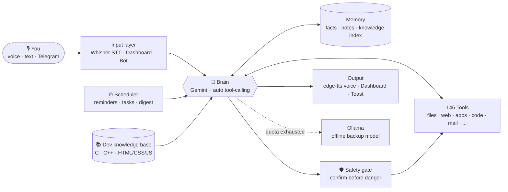
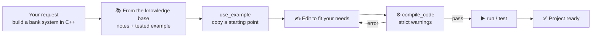

<div align="center">

```
 ██████╗ ██╗      █████╗  ██████╗██╗███████╗██████╗
██╔════╝ ██║     ██╔══██╗██╔════╝██║██╔════╝██╔══██╗
██║  ███╗██║     ███████║██║     ██║█████╗  ██████╔╝
██║   ██║██║     ██╔══██║██║     ██║██╔══╝  ██╔══██╗
╚██████╔╝███████╗██║  ██║╚██████╗██║███████╗██║  ██║
 ╚═════╝ ╚══════╝╚═╝  ╚═╝ ╚═════╝╚═╝╚══════╝╚═╝  ╚═╝
```

### Your AI companion. Always listening. Always on your side.

*A Jarvis-style assistant that lives on your Windows PC: it talks, listens, finds files, writes code, and tells you when the job is done.*

<br>


-8E75B2?style=for-the-badge&logo=googlegemini&logoColor=white)


<br>

[**Quick start**](#-quick-start-4-steps) &nbsp;·&nbsp; [**Terminal cheat sheet**](#-terminal-cheat-sheet-all-commands-in-one-place) &nbsp;·&nbsp; [**Features**](#-what-glacier-can-do) &nbsp;·&nbsp; [**Voice**](#-voice) &nbsp;·&nbsp; [**Coding mode**](#-coding-mode) &nbsp;·&nbsp; [**Reminders**](#-reminders-that-respect-time) &nbsp;·&nbsp; [**Safety**](#-safety-by-design) &nbsp;·&nbsp; [**.env guide**](#-env-settings-full-list) &nbsp;·&nbsp; [**Help**](#-troubleshooting)

</div>

<br>

---

## ✦ What is Glacier

Glacier is a **personal AI assistant** that runs directly on your PC. It has an ice-and-aurora dashboard, an always-on microphone, and 146 tools: opening apps, finding files, web research, reminders, email, and building complete projects in C / C++ / HTML.

|  |  |
|---|---|
| 🧊 **Free** | Uses a free Google Gemini API key. No subscription. |
| 🎙️ **Hands-free** | Just say "Glacier, ...". No button to press. |
| 🌍 **Multilingual** | Speaks 65 languages, detects the language as you speak, and translates between any of them. |
| 🛡️ **Safe** | Deleting, running commands, sending email and similar actions ask for your confirmation **in code**. The AI cannot say "yes" for itself. |
| 🔌 **Yours** | Your data stays on your PC. The API key lives only in `.env`. |

<br>

## ✦ Architecture



<br>

## ✦ Quick start (4 steps)

> **Requirements:** Windows 10/11, Python 3.12 (tick *Add python.exe to PATH* while installing), an internet connection, and a free Gemini key.

| # | What to do | How |
|:-:|---|---|
| **1** | Open the folder | The Glacier folder (the one with `install.bat` in it). |
| **2** | Double-click **`install.bat`** | It creates `.venv`, installs the libraries, creates `.env` and opens it in Notepad. |
| **3** | Paste your key | In Notepad, put your free key after `GEMINI_API_KEY=` ([get one here](https://aistudio.google.com/apikey)) and save. |
| **4** | Double-click **`run.bat`** | The dashboard opens. 🎉 |

> 💡 You can run **`doctor.bat`** first to check that everything is fine. It tells you what is broken and how to fix it.

### Start automatically when the PC turns on (in the tray)

In a terminal, **inside** the Glacier folder:

```powershell
python setup_autostart.py            # turn on
python setup_autostart.py --remove   # turn off
```

> ⚠️ If you are in a `.venv` terminal, plain `python` is enough. In PowerShell, writing `.venv\Scripts\python` directly gives an error; you have to write `.\.venv\Scripts\python`.

<br>

## ✦ What Glacier can do

<table>
<tr>
<td width="50%" valign="top">

### 🗣️ Chat and voice
Mixed Hindi-English text, an always-on mic, a gentle male voice, offline Whisper speech-to-text, a wake word, and a system tray icon.

### 🖥️ Apps and PC
Open/close apps, volume, brightness, media keys, lock, power (with confirmation), clipboard, dark mode, system status, disk hogs.

### 📁 Files
Instant search across the whole drive. Read PDF, DOCX, XLSX, CSV. Write, edit, move, copy, rename, delete (to the Recycle Bin), zip/unzip, organize Downloads with undo.

### 🌐 Web and info
Search, read pages, Wikipedia, YouTube, weather, news, currency, units, calculator, dictionary.

### 🔬 Deep research
A cited report from several sources, saved in `Documents\Glacier Reports`.

</td>
<td width="50%" valign="top">

### 🧠 Memory
Remembers facts, a knowledge index (BM25) over your own documents, notes, todos, calendar, contacts.

### ⏰ Reminders and schedules
"In 10 minutes", "tomorrow at 8 am", daily/weekly repeats, scheduled AI tasks, page monitors, a morning digest, battery/disk/CPU alerts.

### 👁️ Vision and control
Look at the screen, understand images, OCR, mouse/keyboard control (only after your permission), a screen agent.

### 🌍 Browser agent
Open pages with Playwright, click, type, take snapshots.

### 💬 Comms
WhatsApp (desktop app), email (IMAP/SMTP), a Telegram bot (use Glacier and your files from your phone).

### 🔗 API server
Set `API_SERVER_ENABLED=true` and other apps can use Glacier at `http://127.0.0.1:8765/v1/chat/completions`.

</td>
</tr>
</table>

<details>
<summary><b>📋 Full tool count (146)</b></summary>

<br>

| Category | Tools | Category | Tools |
|---|:-:|---|:-:|
| Developer | 20 | Web | 7 |
| Files | 16 | Info | 7 |
| System | 12 | Comms | 7 |
| Productivity | 12 | Terminal | 6 |
| Schedule | 11 | Memory | 6 |
| PC control | 11 | Apps | 4 |
| Browser | 11 | Vision | 4 |
| Language | 4 | Skills / MCP / Agent / Custom | 8 |

To turn off any tool, set `DISABLED_TOOLS=run_command,run_python` or `DISABLED_CATEGORIES=control,browser` in `.env`.

</details>

<br>

## ✦ Tools reference (all 146)

This list is generated from the actual code. ⚠️ = **runs only after confirmation**. Descriptions are in English because that is what Glacier's AI reads.

<details>
<summary><b>💻 Developer (C / C++ / HTML / C#)</b> · 20 tools</summary>

<br>

| Tool | What it does |
|---|---|
| `analyze_code`  | Analyze C/C++ code for bugs: cppcheck if installed, otherwise a strict compile (-Wshadow -Wconversion -Wnull-dereference -Wformat=2). |
| `build_project` ⚠️ | Build a project folder: CMakeLists.txt -&gt; cmake, Makefile -&gt; make, *.csproj -&gt; dotnet build, otherwise compile all .c/.cpp files. |
| `check_html`  | Validate an HTML file: structure (doctype, lang, charset, viewport, title, unclosed/mismatched tags), accessibility (alt text, form labels),... |
| `coding_guide`  | Return Glacier's expert coding rules and workflow for a language: 'html', 'c', 'cpp', 'csharp' (empty = all). |
| `compile_code`  | Compile a C or C++ source file (or every .c/.cpp in a folder) with warnings on (-Wall -Wextra -Wpedantic) and return the compiler errors/warnings. |
| `create_project`  | Create a starter project and return its folder. |
| `dev_reference`  | Search Glacier's built-in C / C++ / HTML / CSS / JavaScript reference notes (syntax, STL, pitfalls, compiler errors, project blueprints). |
| `dev_toolchain`  | Show which developer tools are installed (gcc, g++, clang, cmake, make, dotnet, node, git, clang-format, cppcheck) and how to install missing ones. |
| `format_code`  | Format a C/C++ source file in place with clang-format (4-space indent). |
| `gemini_models`  | List the Gemini models this API key can use (to pick a stronger model for coding via CODING_MODELS in .env). |
| `html_screenshot`  | Render an HTML file in a headless browser and save a screenshot (PNG). |
| `install_compiler` ⚠️ | Install a free C/C++ compiler (GCC via WinLibs) on Windows using winget. |
| `install_offline_docs` ⚠️ | Download C/C++ (cppreference) and HTML/CSS/JavaScript (MDN) documentation from GitHub once (about 150-250 MB, a few minutes) and index it so... |
| `list_examples`  | List Glacier's tested example projects. |
| `local_model_advice`  | Check this PC's RAM/GPU and recommend an offline coding model for Ollama, with exact install steps. |
| `lookup_docs`  | Look up live official documentation (cppreference.com for C/C++, MDN for HTML/CSS/JavaScript) for a function, header, tag or property. |
| `offline_docs_status`  | Show whether the offline C/C++/HTML/CSS/JS documentation is installed and the progress of a running download. |
| `preview_html`  | Open an HTML file in the user's default browser. |
| `run_program` ⚠️ | Run a compiled program (.exe) - or a C/C++ source file, which is compiled first - and return its output and exit code. |
| `use_example`  | Copy a tested example project into a new folder as a starting point (default: Documents\Glacier Projects\&lt;name&gt;), then adapt it with edit_file... |

</details>

<details>
<summary><b>📁 Files</b> · 16 tools</summary>

<br>

| Tool | What it does |
|---|---|
| `copy_file` ⚠️ | Copy a file or folder (original stays). |
| `create_folder`  | Create a new folder (parents too). |
| `delete_file` ⚠️ | Delete a file or folder. |
| `edit_file` ⚠️ | Replace exact text inside an existing text file (old_text must appear exactly once). |
| `file_info`  | Size, dates and type of a file or folder. |
| `find_files`  | Find files/folders by (part of) name anywhere on C: and D: (instant, uses an index; also catches brand-new files). |
| `list_folder`  | List the contents of a folder (use 'desktop', 'downloads', 'documents' as shortcuts). |
| `move_file` ⚠️ | Move (cut-paste) a file or folder. |
| `open_path`  | Open a file with its default app, or open a folder in File Explorer. |
| `organize_downloads` ⚠️ | Sort files in the Downloads folder into subfolders by type (Images, Documents, Videos, Music, Archives, Installers, Others). |
| `read_file`  | Read a file's text (txt, md, code, csv, json, PDF, Word .docx, Excel .xlsx ...). |
| `rename_file` ⚠️ | Rename a file/folder (new_name is just the new name, not a path). |
| `undo_organize_downloads`  | Undo the last organize_downloads: move every file back to where it was. |
| `unzip_file`  | Extract a .zip into a new folder next to it (or into destination). |
| `write_file` ⚠️ | Create a text file with the given content. |
| `zip_folder`  | Compress a folder (or single file) into a .zip next to it (or at output_path). |

</details>

<details>
<summary><b>🖥️ System</b> · 12 tools</summary>

<br>

| Tool | What it does |
|---|---|
| `clipboard_read`  | Return the text currently on the Windows clipboard. |
| `clipboard_write`  | Put text on the Windows clipboard so the user can paste it anywhere. |
| `empty_recycle_bin` ⚠️ | Permanently empty the Recycle Bin. |
| `get_disk_hogs`  | Which running programs use the most RAM and CPU right now (helps when the PC feels slow). |
| `get_network_info`  | Current network: Wi-Fi name, IP addresses, and whether the internet works. |
| `get_system_status`  | CPU, RAM, every disk, battery, uptime and network speed - a quick health report of this PC. |
| `lock_screen`  | Lock the Windows session (Win+L). |
| `media_control`  | Press a media key: play_pause / next / prev / stop. |
| `set_brightness`  | Set laptop screen brightness (0-100). |
| `set_dark_mode`  | Switch Windows between dark mode (True) and light mode (False). |
| `set_volume`  | Control speaker volume. |
| `system_power` ⚠️ | Power control: action = sleep / shutdown / restart / hibernate / logoff / cancel. |

</details>

<details>
<summary><b>✅ Productivity (todos, notes, calendar, contacts)</b> · 12 tools</summary>

<br>

| Tool | What it does |
|---|---|
| `add_contact`  | Save or update a contact (used by send_whatsapp / send_email so you can say 'Papa ko message bhejo'). |
| `add_event`  | Add an event to the local calendar. |
| `add_note`  | Save a note (ideas, meeting points, anything to remember in detail). |
| `add_todo`  | Add an item to the to-do list. |
| `complete_todo`  | Mark a to-do as done, by number (#id) or words from its text. |
| `delete_event`  | Delete a calendar event by number (#id) or words from its title. |
| `delete_note`  | Delete a note by number (#id). |
| `delete_todo`  | Remove a to-do entirely, by number (#id) or words from its text. |
| `find_contact`  | Find a saved contact by name (empty = list all). |
| `list_events`  | Show calendar events for the next N days (default 7; use 1 for today). |
| `list_todos`  | Show the to-do list (pending items; set show_done=True to include completed). |
| `search_notes`  | Search saved notes by words (empty query = latest notes). |

</details>

<details>
<summary><b>⏰ Reminders aur schedules</b> · 11 tools</summary>

<br>

| Tool | What it does |
|---|---|
| `add_reminder`  | Set a reminder. |
| `cancel_reminder`  | Cancel a reminder by its number (#id) or by words from its text. |
| `cancel_scheduled_task`  | Cancel a scheduled task by number (#id) or words from its name. |
| `edit_reminder`  | Change an existing reminder (find it by #id or words in its text): new text, new time ('kal 9 baje', '7pm') and/or new repeat. |
| `list_reminders`  | List upcoming reminders and running timers. |
| `list_scheduled_tasks`  | List all scheduled (recurring or future) Glacier tasks. |
| `list_watches`  | List all monitored pages. |
| `remove_watch`  | Stop monitoring a page by number (#id) or part of its URL. |
| `schedule_task`  | Schedule Glacier itself to do something later or repeatedly (like a cron job): at the given time Glacier runs 'prompt' as if the user typed it... |
| `set_timer`  | Start a countdown timer, e.g. |
| `watch_page`  | Monitor a web page. |

</details>

<details>
<summary><b>🖱️ PC control (mouse / keyboard / power)</b> · 11 tools</summary>

<br>

| Tool | What it does |
|---|---|
| `disable_computer_control`  | Turn mouse/keyboard control off immediately. |
| `enable_computer_control` ⚠️ | Ask the user's permission to control mouse & keyboard for N minutes (needed before mouse_click, type_text, press_key, screen_agent ...). |
| `focus_window`  | Bring a window to the front by part of its title (e.g. |
| `get_screen_info`  | Screen resolution and current mouse position. |
| `mouse_click`  | Click at screen pixel coordinates (x, y). |
| `mouse_move`  | Move the mouse pointer to (x, y). |
| `press_key`  | Press a key or shortcut, e.g. |
| `screen_agent` ⚠️ | Do a multi-step task by LOOKING at the screen and using mouse/keyboard like a person (last resort when no direct tool exists, e.g. |
| `scroll_screen`  | Scroll the active window: positive = up, negative = down (e.g. |
| `show_desktop`  | Minimize everything and show the desktop (Win+D). |
| `type_text`  | Type text into whatever has keyboard focus right now (supports Hindi/any language). |

</details>

<details>
<summary><b>🌍 Browser agent</b> · 11 tools</summary>

<br>

| Tool | What it does |
|---|---|
| `browser_click` ⚠️ | Click a button/link/element by its visible text, label, or a CSS selector ('css=#submit'). |
| `browser_close`  | Close Glacier's automation browser. |
| `browser_links`  | List links on the current page (optionally only those whose text/URL contains a word). |
| `browser_open`  | Open a URL in Glacier's automation browser (separate window with its own saved logins). |
| `browser_press`  | Press a key on the current page, e.g. |
| `browser_read`  | Read the visible text of the current page in Glacier's browser. |
| `browser_screenshot`  | Screenshot of the current page in Glacier's browser. |
| `browser_scroll`  | Scroll the page: direction 'down' or 'up'. |
| `browser_snapshot`  | Accessibility snapshot of the page (buttons, links, inputs with their names) - use this to decide what to click/type. |
| `browser_tabs`  | Manage tabs: action = list / new (opens url) / switch (to index) / close (current tab) / back. |
| `browser_type` ⚠️ | Type text into an input field (found by label/placeholder/name/css). |

</details>

<details>
<summary><b>🔎 Web</b> · 7 tools</summary>

<br>

| Tool | What it does |
|---|---|
| `download_file` ⚠️ | Download a file from a public URL into the Downloads folder (never overwrites, max 500 MB). |
| `fetch_url`  | Download a web page and return its readable text (no browser needed). |
| `http_request` ⚠️ | Make an HTTP request to a public URL. |
| `open_website`  | Open a website in the default browser. |
| `web_search`  | Search the web (DuckDuckGo) and return the top results with title, snippet and link. |
| `wikipedia`  | Look up a topic on Wikipedia and return the summary (lang 'en' or 'hi'). |
| `youtube_play`  | Find the best YouTube video for the query and open it in the browser. |

</details>

<details>
<summary><b>ℹ️ Info (weather, news, currency...)</b> · 7 tools</summary>

<br>

| Tool | What it does |
|---|---|
| `calculate`  | Exactly evaluate a math expression, e.g. |
| `convert_currency`  | Convert money using live exchange rates, e.g. |
| `convert_units`  | Convert between units: length, weight, volume, data size, speed, area (incl. |
| `define_word`  | English dictionary meaning, part of speech and an example for a word. |
| `get_datetime`  | Current date and time. |
| `news_headlines`  | Latest news headlines. |
| `weather`  | Current weather and the next few days' forecast. |

</details>

<details>
<summary><b>💬 Comms (WhatsApp, email, Telegram)</b> · 7 tools</summary>

<br>

| Tool | What it does |
|---|---|
| `email_read`  | Read one email's text by its #number from email_unread / email_search. |
| `email_search`  | Search the inbox by sender/subject/text and list matches. |
| `email_unread`  | List the latest unread emails (sender, subject, date). |
| `send_email` ⚠️ | Send an email from the user's own account. |
| `send_file_to_phone` ⚠️ | Send a file from this PC to the user's phone via the Glacier Telegram bot (max 50 MB). |
| `send_telegram_message`  | Send a text message to the user's own phone via the Glacier Telegram bot (set up with TELEGRAM_BOT_TOKEN). |
| `send_whatsapp` ⚠️ | Send a WhatsApp message through the WhatsApp desktop app. |

</details>

<details>
<summary><b>⌨️ Terminal aur git</b> · 6 tools</summary>

<br>

| Tool | What it does |
|---|---|
| `git_commit` ⚠️ | Stage all changes and commit them with the message. |
| `git_diff`  | Show the uncommitted changes (diff) of a repository. |
| `git_log`  | Show the latest commits of a repository. |
| `git_status`  | Show git status (changed/untracked files and branch) of a repository folder. |
| `run_command` ⚠️ | Run a Windows PowerShell command and return its output. |
| `run_python` ⚠️ | Run a Python snippet (use print() for output) and return what it printed. |

</details>

<details>
<summary><b>🧠 Memory</b> · 6 tools</summary>

<br>

| Tool | What it does |
|---|---|
| `forget`  | Delete a remembered fact by its number (#id) or by words from it. |
| `index_folder`  | Teach Glacier your documents: index a folder (PDF, Word, Excel, text, code ...) so search_knowledge can answer questions from them. |
| `knowledge_status`  | How many documents are indexed for search_knowledge. |
| `recall`  | Look up what is remembered about the user (empty query lists the latest facts). |
| `remember`  | Save a durable fact about the user for future chats (name, preferences, routines, people, projects). |
| `search_knowledge`  | Search inside the documents the user indexed (index_folder). |

</details>

<details>
<summary><b>🪟 Apps</b> · 4 tools</summary>

<br>

| Tool | What it does |
|---|---|
| `close_application`  | Close a running application by name. |
| `create_desktop_shortcut`  | Create a Desktop shortcut for an installed application (works for Store apps like WhatsApp too, with the correct icon). |
| `list_running_apps`  | List the apps that currently have a visible window (what the user sees on screen). |
| `open_application`  | Open any installed Windows application by name - desktop programs AND Microsoft Store apps (WhatsApp, ChatGPT, Spotify ...). |

</details>

<details>
<summary><b>👁️ Vision</b> · 4 tools</summary>

<br>

| Tool | What it does |
|---|---|
| `describe_image`  | Look at an image file (photo, screenshot, scanned page, chart) and answer a question about it. |
| `look_at_screen`  | Look at the user's screen right now (takes a screenshot and asks the vision model) and answer the question: what app is open, read an error... |
| `read_text_from_image`  | OCR: extract all the text from an image or scanned page (works for Hindi + English). |
| `take_screenshot`  | Take a screenshot of the whole screen and save it to Pictures/Glacier Screenshots. |

</details>

<details>
<summary><b>🈂️ Language</b> · 4 tools</summary>

<br>

| Tool | What it does |
|---|---|
| `detect_language`  | Detect which language a piece of text is written in (best effort). |
| `language_support`  | Explain which languages Glacier can read/write/understand, listen to and speak. |
| `translate_file`  | Translate a whole document (pdf, docx, txt, md, csv...) to another language. |
| `translate_text`  | Translate text from any language to any language (e.g. |

</details>

<details>
<summary><b>🤖 Agents</b> · 2 tools</summary>

<br>

| Tool | What it does |
|---|---|
| `deep_research`  | Research a question properly: plans several searches, reads the top web pages, and writes a cited report (saved in Documents/Glacier Reports). |
| `morning_digest`  | Give the user a spoken-style briefing: weather, today's events/reminders/to-dos, top news and PC status. |

</details>

<details>
<summary><b>🧩 Skills</b> · 3 tools</summary>

<br>

| Tool | What it does |
|---|---|
| `install_skill_from_url` ⚠️ | Install an instructions-only skill (a SKILL.md / .md file, agentskills.io style) from a URL (e.g. |
| `list_capabilities`  | List everything Glacier can do (tool categories and names). |
| `list_skills`  | List installed skills (skills/ folder: python plugins and instruction files). |

</details>

<details>
<summary><b>🔌 MCP</b> · 2 tools</summary>

<br>

| Tool | What it does |
|---|---|
| `mcp_call` ⚠️ | Call a tool on an MCP server (see mcp_list_tools). |
| `mcp_list_tools`  | List the tools offered by the MCP servers configured in data/mcp_servers.json. |

</details>

<details>
<summary><b>✨ Custom</b> · 1 tools</summary>

<br>

| Tool | What it does |
|---|---|
| `coin_flip`  | Flip a coin and return heads or tails. |

</details>

> Total **146** tools, of which **27** ⚠️ ask for confirmation.

<br>

## ✦ Voice

Glacier is always listening. Just say: **"Glacier, tell me today's weather"**. After it answers, it keeps listening for 15 seconds even without hearing its name.

- Speaks **65 languages** (edge-tts) and detects the language as you speak (`STT_LANGUAGE=auto`).
- Translate: *"Translate this sentence into Japanese: Hello, how are you?"*
- To change the voice: set `TTS_VOICE=en-IN-NeerjaNeural` (female) or `en-IN-PrabhatNeural` (male, default) in `.env`.
- Mic or voice check: `python voice_test.py` · `python voice_test.py --mic` · `python voice_test.py --all`

<details>
<summary><b>🌍 All 65 languages Glacier speaks</b></summary>

<br>

| | | | |
|---|---|---|---|
| Hindi (`hi`) | Bangla (`bn`) | Tamil (`ta`) | Telugu (`te`) |
| Kannada (`kn`) | Malayalam (`ml`) | Gujarati (`gu`) | Marathi (`mr`) |
| Punjabi (`pa`) | Urdu (`ur`) | Nepali (`ne`) | Sinhala (`si`) |
| Spanish (`es`) | French (`fr`) | German (`de`) | Italian (`it`) |
| Portuguese (`pt`) | Russian (`ru`) | Japanese (`ja`) | Korean (`ko`) |
| Chinese (`zh`) | Arabic (`ar`) | Persian (`fa`) | Turkish (`tr`) |
| Dutch (`nl`) | Polish (`pl`) | Swedish (`sv`) | Danish (`da`) |
| Norwegian (`no`) | Finnish (`fi`) | Greek (`el`) | Hebrew (`he`) |
| Thai (`th`) | Vietnamese (`vi`) | Indonesian (`id`) | Malay (`ms`) |
| Ukrainian (`uk`) | Czech (`cs`) | Hungarian (`hu`) | Romanian (`ro`) |
| Bulgarian (`bg`) | Croatian (`hr`) | Slovak (`sk`) | Slovenian (`sl`) |
| Serbian (`sr`) | Swahili (`sw`) | Afrikaans (`af`) | Amharic (`am`) |
| Khmer (`km`) | Lao (`lo`) | Burmese (`my`) | Georgian (`ka`) |
| Kazakh (`kk`) | Mongolian (`mn`) | Estonian (`et`) | Latvian (`lv`) |
| Lithuanian (`lt`) | Icelandic (`is`) | Welsh (`cy`) | Catalan (`ca`) |
| Macedonian (`mk`) | Albanian (`sq`) | Armenian (`hy`) | Filipino (`tl`) |
| Pashto (`ps`) |  |  |  |

You can check every language's voice with `voice_test.py --all`. Some voices depend on Microsoft's online service; if one does not work, `voice_test.py --all` will tell you.

</details>

<br>

## ✦ Coding mode

Glacier is specially prepared for **C, C++, HTML/CSS/JS** (and C#). It does not just write code, it **compiles and runs it to check**.



| What you get | Details |
|---|---|
| **61 reference sections** | C core + pitfalls, C++ core + STL + errors/idioms, HTML, CSS, JS/DOM, web project blueprints |
| **33 tested examples** | 11 C · 12 C++ · 10 HTML. Every C/C++ example compiles with strict warnings (`-Werror`); the HTML pages were tested in a browser |
| **Live docs** | cppreference and MDN through `lookup_docs` |
| **Offline docs** | Say *"install offline docs"*. cppreference + MDN are downloaded once, then searchable without internet (~150-250 MB) |
| **Better model** | `gemini_models` shows which models work with your key. Set `CODING_MODELS=<model>` in `.env` |
| **Local model** | `local_model_advice` looks at your RAM/GPU and suggests an Ollama coding model |

**Ask for projects like this:**
> *"Build a student management system in C++"* · *"Make a portfolio website in HTML"* · *"Write a menu-driven linked list program in C"* · *"Make a Snake game on canvas"*

To add a new example: put a file in `devkb/examples/<c|cpp|html>/` with `NAME:`, `DESC:` and `KEYWORDS:` comments at the top. `python tests/test_devkb.py` will compile-check it.

<br>

## ✦ Reminders that respect time

Reminders work from the **real current time**.

- **PC was off?** Glacier does **not** announce old reminders. Ones that are very late quietly move to *Missed*. Only reminders within 10 minutes are spoken.
- **Repeating reminders** (daily, weekly, every N minutes) do not run at the old time; they jump straight to the **next correct time**.
- **Dashboard → Reminders → View all:** see every reminder since the beginning. Add new ones, **edit** them, **delete** them. Filters: All · Upcoming · Done · Missed · Repeating.
- You can re-activate a missed reminder by giving it a new time.
- Old reminders are never deleted on their own.

If you want a summary spoken, set `ANNOUNCE_MISSED=true` in `.env`. You can also just say: *"show all reminders"*, *"move this reminder to 9 tomorrow"*.

<br>

## ✦ Extend Glacier

<details>
<summary><b>📱 Glacier on your phone through Telegram</b></summary>

<br>

**Setup:** @BotFather → `/newbot` → token → `TELEGRAM_BOT_TOKEN=` in `.env` → restart Glacier → send `/start` to your bot → it shows your chat id → `TELEGRAM_ALLOWED_CHAT_ID=<id>` in `.env` → restart.

| You send | Glacier does |
|---|---|
| Any text | Handles a normal question/task, just like on the PC |
| 📷 Photo | Looks at the photo and explains it (you can write a question in the caption) |
| 🎙️ Voice message | Turns the voice into text and replies |
| `/status` | Model, today's quota, tool count |
| `/screenshot` | Sends you a screenshot of the PC |
| `/stop` | Stops the running task and the voice |
| `/reset` | Starts a new conversation |

Only the chat set in `TELEGRAM_ALLOWED_CHAT_ID` can command Glacier. Everyone else is silently ignored.

</details>

<details>
<summary><b>🧩 Skills and your own tools (plugins)</b></summary>

<br>

Anything you put in the `skills\` folder is loaded automatically when Glacier restarts.

| File | What it does |
|---|---|
| `*.md` or `SKILL.md` | **Instructions.** Glacier reads and follows them (how to do a job) |
| `*.py` | **New tools.** Use `from registry import tool` and add `@tool(category="mine")` |

Mini example (`skills\hello.py`):

```python
from registry import tool

@tool(category="mine")
def say_hello(name: str) -> str:
    """Greet a person by name."""
    return f"Hello {name}!"
```

Tool parameters can only be `str`, `int`, `float` or `bool`. See `skills\example_skill.py`. Python skills only run if you **copy them in by hand** (they are never installed from the internet, for safety). An instructions-only `.md` skill can also be installed from a URL (with confirmation).

</details>

<details>
<summary><b>🔌 MCP servers (GitHub, Notion, Slack, databases...)</b></summary>

<br>

1. Run `python -m pip install mcp` and install Node.js ([nodejs.org](https://nodejs.org)).
2. Create `data\mcp_servers.json`:

```json
{
  "servers": {
    "fs": { "command": "npx", "args": ["-y", "@modelcontextprotocol/server-filesystem", "D:\\Projects"] },
    "github": { "command": "npx", "args": ["-y", "@modelcontextprotocol/server-github"],
                "env": { "GITHUB_PERSONAL_ACCESS_TOKEN": "ghp_..." } }
  }
}
```

3. Restart Glacier. Say: *"show MCP tools"*. An outside server can do anything, so `mcp_call` **always asks for confirmation**.

</details>

<br>

## ✦ Safety by design

<table>
<tr>
<td width="33%" valign="top">

**🔒 Code-gated**

Deleting, overwriting, running commands, sending email/WhatsApp, power actions, downloads and installs all ask for confirmation **in code**. The AI cannot say "yes" for itself.

</td>
<td width="33%" valign="top">

**🧱 Protected paths**

System folders, `.env` and password paths are blocked. Deleting always goes to the Recycle Bin.

</td>
<td width="33%" valign="top">

**🕸️ Untrusted web**

Content that comes from the web is marked "untrusted" to guard against prompt injection. Secrets are redacted in logs.

</td>
</tr>
</table>

<br>

## ✦ Terminal cheat sheet (all commands in one place)

> **How to open a terminal:** In VS Code, open the Glacier folder → <kbd>Ctrl</kbd> + <kbd>`</kbd> (backtick key). Or in Windows, **Shift + right-click** on empty space in the Glacier folder → **"Open in Terminal"**.
>
> **Most important:** the terminal must be **inside the Glacier folder** where you can see `main_gui.py`. Check with `dir main_gui.py`. If it is not there, use `cd` to go inside (for example `cd Glacier`).

<details open>
<summary><b>1 · Activating the virtual environment (venv)</b></summary>

<br>

```powershell
.\.venv\Scripts\Activate.ps1      # PowerShell / VS Code terminal
.venv\Scripts\activate.bat        # Command Prompt (cmd)
```

If you see `(.venv)` before the prompt, it is active. After that, `python` and `pip` work directly.

If you get a *"running scripts is disabled"* error, run this once:

```powershell
Set-ExecutionPolicy -Scope CurrentUser RemoteSigned
```

> ⚠️ In PowerShell, writing `.venv\Scripts\python` (without `.\`) gives the error *"module '.venv' could not be loaded"*. Either activate the venv and write just `python`, or write `.\.venv\Scripts\python`.

</details>

<details open>
<summary><b>2 · Install and setup</b></summary>

<br>

| Task | Command |
|---|---|
| Everything in one go (recommended) | `install.bat` (double-click) |
| Create the venv yourself | `py -3.12 -m venv .venv` |
| Install/update libraries | `python -m pip install --upgrade pip` then `python -m pip install -r requirements.txt` |
| If one library fails | `python -m pip install <library-name>` |
| Browser control (Playwright) | `python -m pip install playwright` then `python -m playwright install chromium` |
| MCP support (optional) | `python -m pip install mcp` (Node.js is also needed) |
| See installed libraries | `python -m pip list` |
| Python version | `python --version` (should be 3.12) |
| Glacier health check | `python doctor.py` or `doctor.bat` |
| Health check + 1 real AI call | `python doctor.py --selftest` |

</details>

<details open>
<summary><b>3 · Running Glacier</b></summary>

<br>

| How | Command / File | When to use |
|---|---|---|
| Dashboard (normal) | `run.bat` (double-click) | Everyday use |
| Dashboard from a terminal | `python main_gui.py` | When you want to see errors |
| Hidden (in the tray) | `python main_gui.py --background` | This is what autostart uses |
| Terminal chat only | `python main.py` or `run_console.bat` | Without the dashboard |
| Voice in the terminal | `python main.py --voice` | Talk by mic, in the console |
| Health check | `python main.py --doctor` | When something seems broken |

> When you close the dashboard, Glacier goes to the tray. To quit completely, right-click the tray icon → **Quit**.

</details>

<details open>
<summary><b>4 · Auto-start (Glacier when the PC turns on)</b></summary>

<br>

```powershell
python setup_autostart.py             # turn on
python setup_autostart.py --remove    # turn off
```

| Task | How |
|---|---|
| Open the Startup folder | `Win + R` → `shell:startup` → Enter |
| Check what is set | `start_glacier.bat` should be there |
| See what is written inside it | `Get-Content "$env:APPDATA\Microsoft\Windows\Start Menu\Programs\Startup\start_glacier.bat"` |
| List all startup entries | `Get-CimInstance Win32_StartupCommand \| Select-Object Name, Command, Location \| Format-List` |
| Turn it off from Windows | `Ctrl + Shift + Esc` → **Startup apps** → Glacier → Disable |
| Test | Restart the PC. Glacier should be running in the tray (inside the `^` arrow on the taskbar) |

**Important:** if you move the Glacier folder somewhere else or rename it, run `python setup_autostart.py` **again**. The old entry keeps pointing to the old path and you will get a "file not found" error.

</details>

<details>
<summary><b>5 · Checking voice and mic</b></summary>

<br>

| Task | Command |
|---|---|
| Test the voice (speaker) | `python voice_test.py` |
| Test the mic (finds the right mic) | `python voice_test.py --mic` |
| Test the voice for all languages | `python voice_test.py --all` |
| Listen to the voices as well | `python voice_test.py --all --play` |
| Mic hears too little | Lower `MIC_MIN_LEVEL` in `.env` (for example `50`) |
| Windows permission for the mic | Settings → Privacy & security → Microphone → ON |

</details>

<details>
<summary><b>6 · How to apply a new patch / update</b></summary>

<br>

Whenever you get a `glacier_vX_....zip` patch:

1. **Extract** the zip into a separate folder.
2. Copy the files inside into the Glacier folder, into the **same name and same sub-folder** (replace them). For example `tools\dev.py` → Glacier's `tools\` folder.
3. **Never touch:** your `.env` and the `data\` folder (they hold your memory, reminders and notes).
4. If the patch changed `requirements.txt`: `python -m pip install -r requirements.txt`
5. **Close and restart** Glacier (`run.bat`).
6. Run `python doctor.py` once.

**Patch order:** patches are built on top of earlier patches. Apply them in order of the number in the name (v4.7, v4.8, ...).

</details>

<details>
<summary><b>7 · Local API server (using Glacier from other apps)</b></summary>

<br>

Set `API_SERVER_ENABLED=true` in `.env` and restart Glacier. A token is created automatically in `data\api_token.txt`. The server runs only on your PC (`127.0.0.1:8765`).

```powershell
$t = Get-Content data\api_token.txt
Invoke-RestMethod http://127.0.0.1:8765/health
Invoke-RestMethod -Uri http://127.0.0.1:8765/ask -Method Post `
  -Headers @{ "X-Glacier-Token" = $t } -ContentType "application/json" `
  -Body '{"text":"tell me today'"'"'s weather"}'
```

OpenAI-style endpoint: `POST http://127.0.0.1:8765/v1/chat/completions` (header `Authorization: Bearer <token>`).

</details>

<details>
<summary><b>8 · Ollama (offline backup AI)</b></summary>

<br>

```powershell
ollama --version
ollama pull qwen2.5-coder:7b     # for coding (pick the size to match your RAM/GPU)
ollama pull llama3.2             # general
ollama list                      # which models are installed
```

Tell Glacier **"local model advice"**. It looks at your PC's RAM/GPU and suggests the right model. Then in `.env`:

```ini
OPENAI_COMPAT_BASE_URL=http://localhost:11434/v1
OPENAI_COMPAT_MODEL=qwen2.5-coder:7b
```

When the Gemini quota runs out or Gemini is unavailable, Glacier switches to this model.

</details>

<details>
<summary><b>9 · Backup, reinstall, uninstall</b></summary>

<br>

| Task | How |
|---|---|
| **Backup** | Just copy the `.env` file and the `data\` folder to a safe place. That is everything you have |
| **Restore** | Put `.env` and `data\` back into the new Glacier folder |
| **Venv got broken** | Delete the `.venv` folder, then run `install.bat` again |
| **Remove autostart** | `python setup_autostart.py --remove` |
| **Remove completely** | First remove autostart, choose "Quit" from the tray icon, then delete the Glacier folder |
| **Change the old key** | Change `GEMINI_API_KEY=` in `.env`, restart Glacier |

</details>

<details>
<summary><b>10 · Developer tests</b></summary>

<br>

```powershell
python tests/test_core.py        # core logic
python tests/test_e2e.py         # end-to-end
python tests/test_devkb.py       # knowledge base + all examples compile
python tests/test_reminders.py   # reminders + PC-was-off logic
```

</details>

<br>

## ✦ Dashboard guide

| Where | What it is |
|---|---|
| **Big mic button** | Shows the mic state (listening / muted). Click to mute/unmute |
| **Left sidebar: 🏠 Home** | Main screen |
| **💬 Chat** | Past conversations, "New chat", "Stop voice" |
| **📁 Files** | Search files/folders by name, browse folders |
| **🔧 Tools** | What Glacier can do. Click one and an example command appears in the input |
| **⚙️ Settings** | Mic ON/OFF, spoken replies, require "Glacier", choose voice, listening language, speaking speed, language voice test, today's quota |
| **Reminders card → View all** | All reminders: view, add, edit, delete |
| **Recent activity → View all** | The full list of everything Glacier has done, with dates |
| **System status** | CPU, RAM, battery, live |
| **Input box at the bottom** | You can type as well as speak (press Enter) |

<br>

## ✦ Talking to Glacier

<details>
<summary><b>💬 Sample commands (click to see)</b></summary>

<br>

| Category | Say |
|---|---|
| **Apps** | "Open Chrome" · "Close Calculator" · "Set volume to 40" |
| **Files** | "Find PDF files in Downloads" · "Read this file" · "Organize Downloads" |
| **Web** | "Tell me today's AI news" · "Weather in Delhi" · "How many rupees is 100 dollars" |
| **Research** | "Do deep research on this topic: quantum computing" |
| **Reminders** | "Remind me about tea in 10 minutes" · "Remind me about the meeting tomorrow at 8 am" · "Remind me about my medicine every night at 10" · "Show all reminders" |
| **Memory** | "Remember that I like tea" · "Show my to-do list" |
| **Screen** | "What is on the screen?" · "Take a screenshot" |
| **Mail** | "Tell me my unread emails" |
| **Language** | "Translate this sentence into Japanese: ..." |
| **Coding** | "Build a bank management project in C++" · "Make a portfolio in HTML" · "Fix the error in this C code" |
| **Docs** | "Install offline docs" · "Show the std::vector reference" |
| **System** | "Tell me the system status" · "What is filling up the disk?" · "Show git status" |
| **Models** | "Show Gemini models" · "Give local model advice" |

</details>

<br>

## ✦ .env settings (full list)

All settings live in the `.env` file (a copy of `.env.example`). A line that starts with `#` is off; remove the `#` to turn it on. **Do not show your key or passwords to anyone.**

<details>
<summary><b>🔑 Required and identity</b></summary>

<br>

| Setting | Default | Meaning |
|---|---|---|
| `GEMINI_API_KEY` | (empty) | **Required.** Free key: aistudio.google.com/apikey |
| `USER_NAME` | `Shyam` | Glacier calls you by this name |
| `USER_ADDRESS` | `Shyam sir` | How it addresses you ("Shyam sir" / "Sir") |

</details>

<details>
<summary><b>🧠 Model and AI</b></summary>

<br>

| Setting | Default | Meaning |
|---|---|---|
| `MODEL_NAME` | auto | Main Gemini model (fine to leave empty) |
| `AUTO_DISCOVER_MODELS` | `true` | Find the models that work with your key by itself |
| `CODING_MODELS` | (empty) | A better model for coding, comma-separated |
| `DAILY_REQUEST_LIMIT` | `500` | Only for the quota meter |
| `OPENAI_COMPAT_BASE_URL` | (empty) | Offline backup such as Ollama, for example `http://localhost:11434/v1` |
| `OPENAI_COMPAT_MODEL` | `llama3.2` | Name of the backup model |
| `AUTO_DETECT_OLLAMA` | `true` | Detect Ollama by itself when it is running |

</details>

<details>
<summary><b>🎙️ Voice and mic</b></summary>

<br>

| Setting | Default | Meaning |
|---|---|---|
| `VOICE_ENABLED` | `true` | Glacier answers by voice |
| `TTS_VOICE` | `en-IN-PrabhatNeural` | The voice. Female: `en-IN-NeerjaNeural` |
| `TTS_RATE` | `-4%` | Speaking speed (`+10%` faster, `-10%` slower) |
| `TTS_PITCH` | `-2Hz` | Voice pitch |
| `STT_ENGINE` | `whisper` | `whisper` (offline) or `google` |
| `WHISPER_MODEL` | `base` | `tiny` / `base` / `small` (more accurate, slower) |
| `STT_LANGUAGE` | `auto` | `auto` = detect the language by itself. Or `en`, `hi`, `ja`, `ko` |
| `ALWAYS_LISTEN` | `true` | Keep listening all the time |
| `REQUIRE_WAKE_WORD` | `false` | `true` = you must say "Glacier" first |
| `FOLLOWUP_SECONDS` | `15` | After a reply, keep listening this long without the name |
| `MIC_MIN_LEVEL` | `90` | Lower = more sensitive (50-90 for a quiet mic) |
| `MIC_DEVICE` | (empty) | Empty = default mic |

</details>

<details>
<summary><b>⏰ Reminders, digest, alerts</b></summary>

<br>

| Setting | Default | Meaning |
|---|---|---|
| `ANNOUNCE_MISSED` | `false` | Speak reminders that were missed while the PC was off? (`false` = stay silent) |
| `MISSED_GRACE_MINUTES` | `10` | Reminders up to this many minutes late are still spoken |
| `DIGEST_ENABLED` | `true` | Morning digest (weather + news + calendar) |
| `DIGEST_TIME` | `08:00` | What time each day (if the PC is on) |
| `DIGEST_ON_FIRST_START` | `true` | Give the digest on the first start of the morning |
| `HOME_CITY` | (empty) | Empty = detect from IP |
| `PROACTIVE_ALERTS` | `true` | Alerts for low battery, full disk, stuck CPU |
| `BATTERY_LOW_PERCENT` | `20` | Alert when the battery is below this |

</details>

<details>
<summary><b>🛡️ Safety and tools</b></summary>

<br>

| Setting | Default | Meaning |
|---|---|---|
| `USE_RECYCLE_BIN` | `true` | Delete = Recycle Bin (can be restored) |
| `CONFIRM_TTL_SECONDS` | `300` | How long a confirmation stays valid |
| `EXTRA_BLOCKED_FOLDERS` | (empty) | More folders Glacier must not touch (separate with `\|`) |
| `DISABLED_TOOLS` | (empty) | Tools to turn off, for example `run_command,run_python` |
| `DISABLED_CATEGORIES` | (empty) | Turn off a whole category, for example `control,browser,comms` |
| `SEARCH_DRIVES` | `C: D: E: F:` | Drives for file search (separate with `\|`) |
| `INDEX_FILES_ON_START` | `true` | Build the index for instant file search |

</details>

<details>
<summary><b>🌐 Browser, window, channels</b></summary>

<br>

| Setting | Default | Meaning |
|---|---|---|
| `BROWSER_CHANNEL` | `chrome` | `chrome` / `msedge` / `chromium` |
| `BROWSER_HEADLESS` | `false` | Run the browser without a window |
| `START_HIDDEN` | `false` | Keep the window hidden at start (in the tray) |
| `TRAY_ENABLED` | `true` | System tray icon |
| `TELEGRAM_BOT_TOKEN` | (empty) | Token you got from @BotFather |
| `TELEGRAM_ALLOWED_CHAT_ID` | (empty) | Only this chat can command Glacier |
| `EMAIL_ADDRESS` | (empty) | Your email |
| `EMAIL_APP_PASSWORD` | (empty) | Gmail App Password (2-step must be ON) |
| `API_SERVER_ENABLED` | `false` | Local API server |
| `API_SERVER_PORT` | `8765` | Port of the API server |

</details>

<br>

## ✦ Optional upgrades

All of these are optional. Do them only when you need them.

| Item | When you need it | How |
|---|---|---|
| Playwright browser | Browser control | Answer "y" in `install.bat`, or `python -m playwright install chromium` |
| Ollama ([ollama.com](https://ollama.com)) | Offline backup AI | Install → `ollama pull qwen2.5-coder:7b` (or ask `local_model_advice`). Glacier detects it by itself |
| Telegram bot | Control from your phone | In Telegram, **@BotFather** → `/newbot` → copy the token → `TELEGRAM_BOT_TOKEN=` in `.env` → restart Glacier → send `/start` to your bot → it shows your chat id → put it in `TELEGRAM_ALLOWED_CHAT_ID=` → restart |
| Gmail App Password | Email | Google Account → Security → turn 2-step ON → App passwords |
| Node.js | MCP servers | nodejs.org |
| Git | Git tools | git-scm.com |

<br>

## ✦ Project layout

```
Glacier/
├── main_gui.py · main.py        # entry points (dashboard / console)
├── brain.py · engines.py        # Gemini chat, tool-calling, model selection
├── safety.py                    # confirm gate, protected paths
├── scheduler.py · timeparse.py  # reminders, tasks, time-gap handling
├── voice.py · langs.py          # TTS/STT, 65-language voices
├── devguide.py · devkb.py       # coding guides + knowledge base search
├── docsync.py                   # offline cppreference / MDN
├── tools/                       # 146 tools (files, web, dev, reminders, ...)
├── channels/                    # Telegram bot, local API server
├── skills/                      # your own plugin skills
├── devkb/
│   ├── ref/                     # reference notes
│   └── examples/{c,cpp,html}/   # tested examples
├── ui/glacier_dashboard.html    # ice / aurora dashboard
└── tests/                       # 46 automated tests
```

<br>

## ✦ Where Glacier keeps things

| What | Where |
|---|---|
| Your settings and key | `.env` (in the Glacier folder) |
| Memory, reminders, todos, notes, contacts, activity | `data\glacier.db` |
| Safety audit (what was confirmed) | `data\audit.log` |
| Errors | `data\errors.log` |
| Offline docs (cppreference / MDN) | `data\docs\docs.db` |
| API server token | `data\api_token.txt` |
| MCP config | `data\mcp_servers.json` |
| Coding projects | `Documents\Glacier Projects\` |
| Research reports | `Documents\Glacier Reports\` |
| Screenshots | `Pictures\Glacier Screenshots\` |

For a **backup**, copying just `.env` and `data\` is enough.

<br>

## ✦ Privacy: what goes where

| Item | Where it goes |
|---|---|
| Your voice (mic) | Converted to text **on the PC itself** (offline Whisper). Audio is never uploaded |
| Your text and tool results | Sent to **Google Gemini** (to produce a reply). Images too, when Glacier looks at a screenshot |
| Glacier's spoken voice | The text goes to Microsoft's online edge-tts service, which sends the audio back |
| Web search | DuckDuckGo |
| Memory, reminders, file index, logs | Only on your PC (`data\`) |
| API key | Only in `.env`. It is hidden in logs |

> ⚠️ Under Google's free-tier terms, content sent through the free API may be used to improve their products. **Do not say or send passwords, bank details or OTPs to Glacier.**

<br>

## ✦ FAQ

<details>
<summary><b>Will Glacier work without internet?</b></summary>

<br>

Partly. Listening (Whisper), files, reminders, notes and offline docs work. But the brain (Gemini) and the voice (edge-tts) need internet. If you set up **Ollama**, the AI also works offline (with a smaller model).

</details>

<details>
<summary><b>Can it delete my files?</b></summary>

<br>

Only after your confirmation, and into the Recycle Bin (you can get them back). Glacier does not touch protected paths such as system folders and `.env` at all.

</details>

<details>
<summary><b>The mic is always ON. Is that safe?</b></summary>

<br>

Your voice is processed on the PC itself. To turn the mic off, click the dashboard mic button (mute), or turn off "Mic always ON" in Settings. If you want to require the word "Glacier": `REQUIRE_WAKE_WORD=true`.

</details>

<details>
<summary><b>What if I get "quota exhausted"?</b></summary>

<br>

The free tier has a daily limit (Flash-Lite ~500 requests/day, Flash fewer). Glacier tells you when it resets. Until then Ollama (if installed) takes over. Today's quota is shown in Settings.

</details>

<details>
<summary><b>Why does Glacier call me "Shyam sir"? Can I change it?</b></summary>

<br>

Change `USER_NAME=` and `USER_ADDRESS=` in `.env`, then restart Glacier.

</details>

<details>
<summary><b>Will it run on Mac or Linux?</b></summary>

<br>

No. Glacier is built only for **Windows 10/11** (app control, tray and autostart are Windows features). The knowledge base and code understanding work anywhere, but the full assistant is Windows only.

</details>

<details>
<summary><b>How is mouse/keyboard control kept safe?</b></summary>

<br>

It is off by default. Glacier first asks you for **a few minutes of permission** through `enable_computer_control`, only then uses the mouse/keyboard, and you can turn it off at any time.

</details>

<details>
<summary><b>What happens to old reminders after the PC was off?</b></summary>

<br>

They are not spoken. They quietly stay in *Reminders → View all → Missed*, where you can set them again or delete them. Repeating ones move to the next correct time.

</details>

<br>

## ✦ Troubleshooting

| Problem | What to do |
|---|---|
| Nothing works | Run **`doctor.bat`**. It tells you what is broken |
| No sound | `python voice_test.py`, then `--mic` and `--all` |
| Mic does not hear | `python voice_test.py --mic`. Look at the output and adjust `MIC_MIN_LEVEL` in `.env` |
| "Quota exhausted" | Free-tier limit: Flash-Lite ~500 requests/day. Glacier tells you when it resets; if Ollama is set up, it switches to that |
| "File not found" when the PC turns on | A startup entry from the old Glacier is left over. Press `Win + R` → `shell:startup`, delete the old Glacier file, then run `python setup_autostart.py` |
| Need to see errors | `data\errors.log` · safety audit: `data\audit.log` |

<br>

## ✦ Honest limits

Glacier's brain is the **Gemini free tier**. It is very useful, but it is not on par with the big paid models (the larger Claude and GPT models). It can be weak on difficult, large coding projects. That is why the compile-and-test loop and the knowledge base are included, to catch mistakes. For a better model, set `CODING_MODELS` or run a larger local model on Ollama.

OpenJarvis's research/infrastructure features (model fine-tuning, GPU telemetry, Rust core, mobile app) were not taken into Glacier, because they are not useful for a Windows assistant.

<br>

## ✦ What still needs checking (honestly)

Glacier's tests (46) and the things I ran in a sandbox all pass. But some things can only be confirmed **on your own PC**:

- **Real Gemini calls**, edge-tts voice, mic quality, Windows-specific things (tray, autostart, MCI audio).
- **Compiler install** (`install_compiler`, WinLibs through winget): whether the package name is right will only show on a PC.
- **Offline docs download** (cppreference / MDN): the first run against the real archive from GitHub will happen on your PC. If very few pages come in, tell me.
- **Mic and some languages' voices** (such as Punjabi, Russian, Ukrainian): send the output of `python voice_test.py --mic` and `--all` and it can be fixed.

<br>

## ✦ Developer

The test commands are in the [Terminal cheat sheet](#-terminal-cheat-sheet-all-commands-in-one-place) above (section 10).

<br>

---

<div align="center">

**Glacier** · Made for **Shyam sir** · Python 3.12 · Gemini · edge-tts · Whisper · pywebview

*Small steps, done daily, become the scholarship.*

</div>
